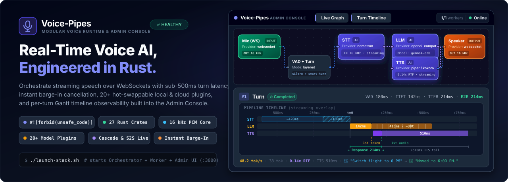
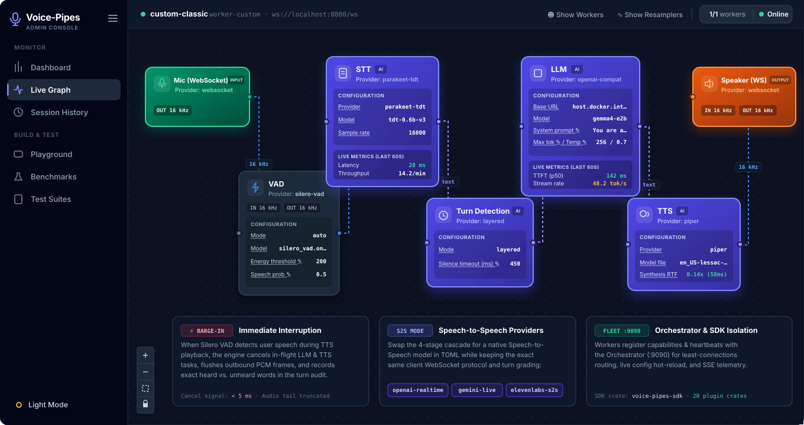
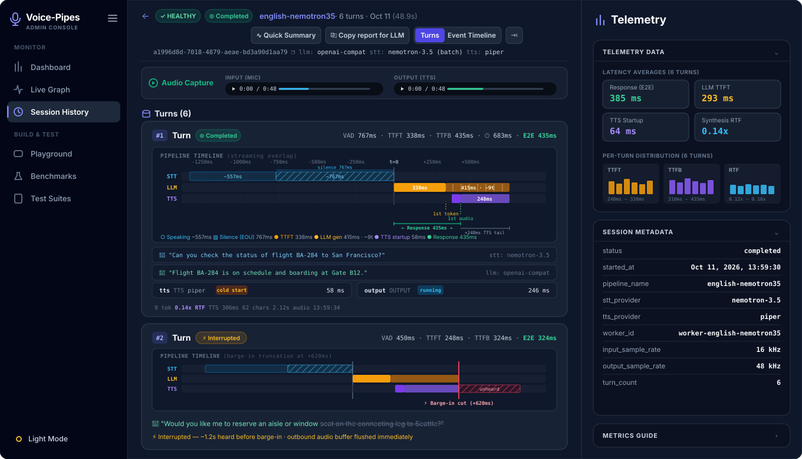

<div align="center">



[](https://github.com/myned-ai/voice-pipes/actions/workflows/core-tests.yml)
[](docs/README.md)
[](docs/getting-started/quickstart-source.md)
[](voice-pipes-cli/tests/workspace_rules.rs)
[](LICENSE)

**[Install & Quickstart](#install)** · **[How to Use It](#4-ways-to-use-voice-pipes)** · **[Architecture](#how-it-works)** · **[Providers](#supported-providers)** · **[Admin Console & Observability](#observability--live-playground)** · **[Voice Pipes Gym](#voice-pipes-gym-rl--regression-harness)** · **[Documentation](docs/README.md)**

</div>

---

## What is Voice Pipes?

**Voice Pipes** is an ultra-low-latency, modular conversational voice AI runtime written in safe Rust (`#![forbid(unsafe_code)]`).

It lets you compose real-time streaming voice agents by plugging any **Speech-to-Text (STT)**, **LLM / Agent**, and **Text-to-Speech (TTS)** provider together with neural **Voice Activity Detection (VAD)**, semantic **turn-taking**, playback-accurate **barge-in interruption**, and **per-turn latency telemetry** — or bridge native **Speech-to-Speech** APIs (OpenAI Realtime, Gemini Live, ElevenLabs Agents) behind the exact same WebSocket session contract.

Out of the box, Voice Pipes ships with local **ONNX and GGUF inference engines** so you can run a complete conversational voice stack **100% offline on your own CPU or GPU** with zero cloud API keys and zero audio leaving your machine.

---

## How It Works



Whether you run a fully local cascade, a hybrid cloud pipeline, or a speech-to-speech model, your client application speaks **one WebSocket protocol** and gets the same deterministic observability, interruption handling, and tool-calling capabilities.

---

## Install

### Option A: One-Command Full Stack (Docker — Zero Host Dependencies)

The interactive launcher runs a setup wizard, downloads the local models you choose, and starts the orchestrator, a voice worker, and the **Admin Console & Live Playground**:

```sh
./launch-stack.sh     # Linux / macOS / WSL
.\launch-stack.ps1    # Windows PowerShell
```

Then open **http://localhost:3000** (sign in using `ADMIN_UI_TOKEN` from `voice-pipes-admin/.env`):
1. Go to **Playground**, click **Connect**, and grant microphone access.
2. **Say something.** The agent transcribes, thinks, and speaks back with live karaoke captions synced word-for-word to the audio.
3. **Interrupt it mid-sentence.** The dedicated barge-in monitor cancels in-flight LLM and TTS immediately and truncates conversation history to the portion actually played on your speaker.
4. Open **Sessions** to inspect the per-turn waterfall breakdown (milliseconds spent in VAD, STT, Turn Detection, LLM, and TTS).

### Option B: Install the Native Rust CLI from Source

Requires Rust 1.91+ (on Linux, install `libasound2-dev` for ALSA audio; `espeak-ng` at runtime for Piper TTS):

```sh
cargo install --locked --git https://github.com/myned-ai/voice-pipes voice-pipes-cli
```

*(Prebuilt binaries and container images accompany tagged releases; see the [release process](docs/contributing/release-process.md).)*

---

## 4 Ways to Use Voice Pipes

### 1. Run a Complete Local Voice Agent in 12 Lines of TOML

No Python environments, no cloud API keys, and nothing leaves your machine:

```toml
# my-agent.toml — 100% local STT + LLM + TTS cascade
[stt]
provider = "parakeet-tdt"
model_dir = "models/parakeet-tdt"

[[text_processor]]
type = "llm"
model = "models/smollm2-360m/SmolLM2-360M-Instruct-Q4_K_M.gguf"
system_prompt = "You are a helpful assistant. Respond briefly."

[tts]
provider = "piper"
model = "models/en_US-lessac-medium.onnx"
```

```sh
voice-pipes models fetch                     # download the default models once (~950 MB)
voice-pipes --config my-agent.toml live      # talk directly via microphone → speaker
```

Want to switch from local Piper TTS to **ElevenLabs**, or swap Parakeet for **Google Chirp 3**? It is a 2-line config edit — no code changes required. Follow the [3-command quickstart](docs/getting-started/quickstart-source.md) or [build your first custom agent](docs/getting-started/first-agent.md).

---

### 2. Use Individual Stages as Standalone CLI Power-Tools

Voice Pipes isn't only an end-to-end conversational loop. Every stage can be run independently from your terminal or scripts without writing boilerplate code:

```sh
# Synthesize speech WAV from text (Piper, Kokoro, VibeVoice, ElevenLabs, or OpenAI TTS):
voice-pipes --config examples/tts/piper.toml tts --text "Welcome to Voice Pipes!" --output welcome.wav

# Transcribe an audio file to text (Parakeet TDT, Nemotron 3.5, Moonshine, Chirp 3, or AssemblyAI):
voice-pipes --config examples/stt/parakeet.toml stt --input welcome.wav

# Live microphone dictation directly to your terminal (STT only):
voice-pipes --config examples/listen/parakeet.toml listen

# Offline audio-to-audio pipeline round-trip (WAV -> STT -> LLM/TTS -> WAV):
voice-pipes --config examples/minimal.toml pipe --input speech.wav --output resynthesized.wav
```

---

### 3. Serve Real-Time WebSockets to Web, Mobile, or Backend Apps

Turn any pipeline configuration into a production multi-session WebSocket worker or a horizontally scaled fleet:

```sh
# Start a real-time WebSocket voice worker:
voice-pipes --config my-agent.toml serve --bind 0.0.0.0:8080
```

Connect from any browser, mobile app, or backend service over the documented [WebSocket wire protocol](docs/clients/protocol.md), or use the [TypeScript](docs/clients/typescript-sdk.md) and [React](docs/clients/react-sdk-integration.md) client guides.

---

### 4. Bridge Native Speech-to-Speech (S2S) Models

Connect **OpenAI Realtime**, **Gemini Live**, or **ElevenLabs Agents** behind the same Voice Pipes worker protocol so you can swap between modular cascades and S2S providers without touching your client code or losing session audit trails:

```sh
export GEMINI_API_KEY="your-key"
voice-pipes --config voice-pipes/examples/live/gemini-live.toml interactive
```

---

## Observability & Live Playground



In conversational voice AI, **latency and interruption quality are the product**. Voice Pipes measures critical-path latency at the engine trait seam using a single monotonic clock across every provider:

- **Per-Turn Waterfall Audit Trail:** Every turn records exact timings for VAD gating, STT finalization, semantic turn detection, LLM time-to-first-token (TTFT), and TTS first audio chunk, alongside both-side WAV recordings and OpenTelemetry spans.
- **Playback-Accurate Barge-In Truncation:** When a user interrupts the agent mid-sentence, the engine immediately cancels in-flight generation and uses the client's `PlaybackReport` (`last_played_offset_ms`) to truncate LLM conversation history to what was actually played.
- **A/B Pipeline Benchmarking:** Pit two pipeline configurations against each other using a synthetic caller, deterministic latency/WER scoring, and diffable reports ([Benchmarking Guide](docs/guides/benchmarking-and-evals.md)).

---

## Why Voice Pipes?

| Capability | What Makes Voice Pipes Different |
|---|---|
| **Native Safe Rust (`#![forbid(unsafe_code)]`)** | Every pipeline stage runs on native OS threads and async tasks with bounded channel hand-off. No Python GIL stalls when models run; deploys as a single compiled binary. |
| **Local-First, Cloud-Ready** | Run STT, LLM, TTS, and VAD 100% offline with zero per-minute API costs, or mix-and-match cloud APIs (`OPENAI_API_KEY`, `GEMINI_API_KEY`, `ELEVENLABS_API_KEY`, `ASSEMBLYAI_API_KEY`). |
| **Surgical Interruption (Barge-In)** | Dedicated barge-in monitor cancels in-flight LLM and TTS within milliseconds of user speech and truncates transcript history using client playback offsets. |
| **Off-Critical-Path Audio Annotators** | Stream 3D avatar lip-sync blendshapes, visemes, or phonemes from sidecars that never block or slow down voice playback ([Audio Annotators Guide](docs/guides/audio-annotators.md)). |
| **Client & Server Tool Calling** | Let the LLM invoke client-side UI/device tools fulfilled by your app, or server-side tools over a gRPC agent link ([Tool Calling Guide](docs/guides/tool-calling.md)). |
| **SemVer-Disciplined Plugin SDK** | All 20+ providers build strictly against [`voice-pipes-sdk`](voice-pipes-sdk/) (`1.0`). Write external STT, TTS, LLM, or VAD crates without forking the engine ([Plugin SDK Guide](docs/extending/plugin-sdk.md)). |

---

## Supported Providers

Every provider listed below is implemented, tested, and ready to run today. Any stage can also run out-of-process over [gRPC split mode](docs/extending/grpc-split-mode.md). See the full [Provider Support Matrix](docs/guides/providers/README.md) and [Roadmap](docs/roadmap.md).

| Stage | Local (Offline, Zero API Keys) | Cloud / Hosted |
|---|---|---|
| **Speech-to-Text (STT)** | [Parakeet TDT](docs/guides/providers/stt/parakeet.md) · [Moonshine](docs/guides/providers/stt/moonshine.md) · [Nemotron 3.5](docs/guides/providers/stt/nemotron-3.5.md) | [AssemblyAI](docs/guides/providers/stt/assemblyai.md) · [Google Cloud STT (Chirp 3, 100+ languages)](docs/guides/providers/stt/google.md) |
| **LLM / Agent** | [Local GGUF (in-process)](docs/guides/providers/llm/local-gguf.md) · [OpenAI-Compatible Server](docs/guides/providers/llm/openai-compatible.md) (Ollama, llama.cpp, vLLM) · [External Agent (gRPC)](docs/guides/providers/llm/agent-grpc.md) | OpenAI · Gemini · Any `/v1/chat/completions` endpoint |
| **Text-to-Speech (TTS)** | [Piper](docs/guides/providers/tts/piper.md) · [Kokoro](docs/guides/providers/tts/kokoro.md) · [Pocket-TTS](docs/guides/providers/tts/pocket.md) · [VibeVoice (GPU)](docs/guides/providers/tts/vibevoice.md) | [ElevenLabs](docs/guides/providers/tts/elevenlabs.md) (word timestamps) · [OpenAI TTS](docs/guides/providers/tts/openai.md) · [Gemini TTS](docs/guides/providers/tts/gemini.md) |
| **Speech-to-Speech (S2S)** | — | [OpenAI Realtime](docs/guides/providers/s2s/openai-realtime.md) · [Gemini Live](docs/guides/providers/s2s/gemini-live.md) · [ElevenLabs Agents](docs/guides/providers/s2s/elevenlabs-agents.md) |
| **VAD & Turn Detection** | Silero VAD · Energy VAD · [Smart Turn](docs/guides/turn-detection-and-interruptions.md) · Layered / Silence · [VAP Anticipatory (Experimental)](docs/guides/turn-detection-and-interruptions.md#vap-anticipatory-experimental) | Provider-native turn signals |

---

## Voice Pipes Gym (RL & Regression Harness)

[`voice-pipes-gym`](voice-pipes-gym/) is an ultra-low-latency, in-memory reinforcement learning environment (`<30 µs` state resets) and deterministic regression harness purpose-built for conversational voice agents:

- **Realistic Acoustic Adversaries:** Test and train agents against hesitation pauses, mid-utterance self-corrections, background babble noise, and network packet loss.
- **Stateful Multi-Turn Environments:** Built-in domain verifiers (Banking, Clinic, Order Management) with strict ground-truth database state verification.
- **Out-of-the-Box RL Training:** Ready-to-run GRPO and DPO training recipes integrated with Hugging Face TRL and vLLM.

Read the [Voice Pipes Gym Guide](docs/guides/voice-pipes-gym.md) and [Architecture Explanation](docs/explanation/voice-pipes-gym.md).

---

## Example Pipelines Cookbook

Explore ready-to-run configurations in [`voice-pipes/examples/`](voice-pipes/examples/) and the full [Example Pipelines Cookbook](docs/guides/examples-and-features.md):

| Example | What It Demonstrates |
|---|---|
| [`voice-pipes/examples/minimal.toml`](voice-pipes/examples/minimal.toml) | Fully offline CPU cascade: Parakeet TDT + Local GGUF LLM + Piper TTS |
| [`voice-pipes/examples/live/moonshine.toml`](voice-pipes/examples/live/moonshine.toml) | Local GPU power stack: Moonshine on CUDA + Smart Turn + VibeVoice TTS |
| [`voice-pipes/examples/live/openai-tts.toml`](voice-pipes/examples/live/openai-tts.toml) | Cloud cascade: AssemblyAI Streaming STT + Hosted LLM + OpenAI TTS |
| [`voice-pipes/examples/live/gemini-live.toml`](voice-pipes/examples/live/gemini-live.toml) | Native Speech-to-Speech session using Gemini Live |
| [`voice-pipes/examples/stt/google.toml`](voice-pipes/examples/stt/google.toml) | Multilingual recognition (100+ languages) with Google Cloud Chirp 3 |
| [`voice-pipes/examples/avatar/`](voice-pipes/examples/avatar/) | 3D Avatar workers with viseme/blendshape annotations and client-side tools |
| [`voice-pipes/examples/grpc/`](voice-pipes/examples/grpc/) | Running pipeline stages in separate processes over gRPC |
| [`examples/reference-agent/`](examples/reference-agent/) | Protocol-complete external Python agent over the `AgentService` gRPC contract |

---

## Documentation Map

Start at **[docs/README.md](docs/README.md)** or jump directly to your workflow:

- **Getting Started:** [Quickstart (Docker)](docs/getting-started/quickstart-docker.md) · [Quickstart (Source)](docs/getting-started/quickstart-source.md) · [Your First Agent](docs/getting-started/first-agent.md) · [Core Concepts](docs/getting-started/concepts.md) · [Architectural Comparison](docs/explanation/comparison.md)
- **Operating & Tuning:** [Configuration](docs/guides/configuration.md) · [Turn Detection & Interruptions](docs/guides/turn-detection-and-interruptions.md) · [Observability](docs/guides/observability.md) · [Fleet & Orchestrator](docs/guides/fleet.md) · [Deployment](docs/guides/deployment.md) · [Admin Console](docs/guides/admin-console.md)
- **Connecting Clients:** [Building a Client](docs/clients/building-a-client.md) · [Wire Protocol](docs/clients/protocol.md) · [TypeScript SDK](docs/clients/typescript-sdk.md) · [React Integration](docs/clients/react-sdk-integration.md)
- **Extending:** [Plugin SDK](docs/extending/plugin-sdk.md) · [Custom Components](docs/extending/custom-component.md) · [Design Decisions](docs/explanation/decisions/README.md)
- **Reference:** [CLI Synopsis](docs/reference/cli.md) · [TOML Config Reference](docs/reference/config.md) · [HTTP API](docs/reference/http-api.md) · [Metrics Glossary](docs/reference/metrics-glossary.md) · [VPO Open Standard](docs/reference/vpo-metrics.md)

*Using an AI coding assistant? Point it at [`docs/llms.txt`](docs/llms.txt) and [`AGENTS.md`](AGENTS.md).*

---

## Repository Layout

| Path | Description |
|---|---|
| [`voice-pipes/`](voice-pipes/) | Core engine library: streaming pipeline, session loop, transport, and fleet orchestrator |
| [`voice-pipes-sdk/`](voice-pipes-sdk/) | SemVer-stable (`1.0`) plugin SDK and trait boundary for all stage providers |
| [`voice-pipes-cli/`](voice-pipes-cli/) | The `voice-pipes` command-line binary and interactive setup wizard |
| [`voice-pipes-onnx/`](voice-pipes-onnx/) · [`voice-pipes-net/`](voice-pipes-net/) | Shared ONNX Runtime session pooling (CPU/CUDA) and network/TLS client policy |
| [`plugins/`](plugins/) | 20 modular stage provider crates (`plugins/{stt,tts,llm,s2s,turn,vad}/*`) built strictly against `voice-pipes-sdk` |
| [`voice-pipes-bench/`](voice-pipes-bench/) | Automated A/B latency, RTF, WER, and synthetic-caller benchmarking suite |
| [`voice-pipes-gym/`](voice-pipes-gym/) | In-memory reinforcement learning environment and regression harness for voice agents |
| [`voice-pipes-admin/`](voice-pipes-admin/) | Admin console, live karaoke playground, and session inspector (React 18 + FastAPI) |
| [`examples/`](examples/) · [`docs/`](docs/) | External client/agent integrations and full documentation |

---

