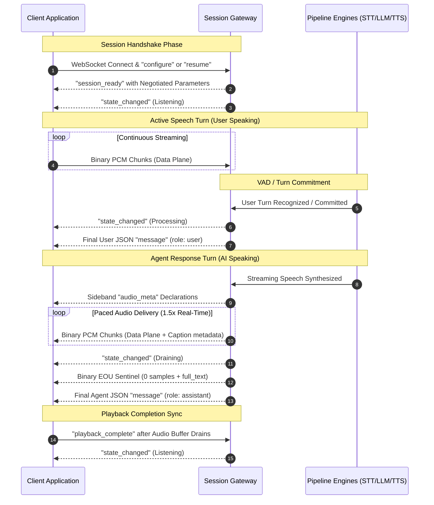
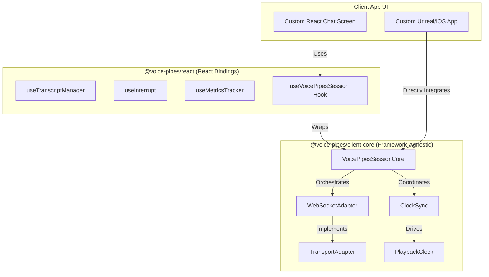
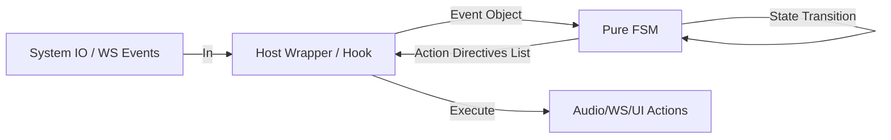

# Voice Pipes Client Integration Specification & Reusability Guide

---

**Status:** Active  
**Author:** Backend + Frontend Architecture  
**Last Reviewed:** 2026-09-19  
**Source of Truth:** Yes  
**Target Audience:** Client Developers, Frontend Engineers, Integration Teams, and LLMs  

---

## 1. Document Overview & Context

This document is the definitive technical specification and integration guide for building client applications that connect to the Voice Pipes platform. 

It is designed to serve as both:
1. **A precise implementation reference** for client engineers writing custom integrations in any language (such as TypeScript, Swift, Kotlin, or Python).
2. **An architectural refactoring catalog** that explains how our existing Admin Playground client code can be modularized and extracted into a highly generic, dual-layered SDK control that our clients can drop into their systems.

### 1.1 Canonical Document Tree Routing

For deep protocol wire schemas, internal gateway operations, and session mechanics, consult the following parent files:
- Live message syntax and capture schemas are in [MESSAGES-AND-EVENTS-SPEC.md](protocol.md).
- Detailed gateway orchestration, state machine transitions, and operator runbooks are in [GATEWAY-EXTENSION-AND-OPERATIONS.md](../extending/gateway-transports-and-engines.md).
- Playground-derived UI protocols and timing flows are in [../../voice-pipes-admin/docs/WEBSOCKET_PROTOCOL.md](protocol-walkthrough.md).

---

## 2. Platform Architecture & Protocol Layering

Voice Pipes clients send and receive messages over a standard WebSocket transport. This transport segregates traffic into two logical sub-planes: the **Control Plane** and the **Data Plane**. This strict segregation ensures high-frequency audio data streams cannot delay or contaminate vital, low-frequency session state transitions (avoiding Head-of-Line blocking).



---

## 3. High-Frequency Data Plane (Binary Framing)

All audio transfer (both microphone capturing and speaker playback) travels via binary WebSocket frames.

### 3.1 Frame Byte Structure
Each binary frame starts with a fixed-size **6-byte header**, followed by a variable-length payload of signed, 16-bit little-endian PCM samples (`pcm_i16_le`).

```
 0                   1                   2                   3
 0 1 2 3 4 5 6 7 8 9 0 1 2 3 4 5 6 7 8 9 0 1 2 3 4 5 6 7 8 9 0 1
+-+-+-+-+-+-+-+-+-+-+-+-+-+-+-+-+-+-+-+-+-+-+-+-+-+-+-+-+-+-+-+-+
|   msg_type    |     flags     |           seq_num             |
+-+-+-+-+-+-+-+-+-+-+-+-+-+-+-+-+-+-+-+-+-+-+-+-+-+-+-+-+-+-+-+-+
|   seq_num (cont. u32 LE)      |         PCM Payload ...       |
+-+-+-+-+-+-+-+-+-+-+-+-+-+-+-+-+-+-+-+-+-+-+-+-+-+-+-+-+-+-+-+-+
|                         PCM Payload ...                       |
+---------------------------------------------------------------+
```

The header bytes are mapped as follows:
- **`msg_type` (Byte 0):** `0x01` represents raw PCM signed 16-bit little-endian audio. `0x02` is reserved for compressed Opus codec packets, which no worker sends or accepts yet: a handshake that asks for `opus` is downgraded to PCM (see the [protocol reference](protocol.md#action-configure--start-a-new-session-handshake)).
- **`flags` (Byte 1):** Bitwise configuration tracking:
  - **Bit 0 (`0x01`):** `FLAG_END_OF_UTTERANCE` (EOU). Indicates the current speech turn is ending. For outbound TTS, this signals the final sample chunk of a sentence block.
  - **Bit 1 (`0x02`):** `FLAG_END_OF_RESPONSE` (EOR). Indicates the conclusion of the entire response (e.g. including downstream asynchronous hooks).
- **`seq_num` (Bytes 2–5):** A little-endian 32-bit unsigned integer representing a monotonic frame counter. It is used to detect packets dropped by the network and is reset on session re-connection.

For serializing and deserializing these frames in standard JavaScript/TypeScript, client implementations must use the layout matching the functions `encodeBinaryFrame` and `decodeBinaryFrame` defined in [voice-pipes-admin/frontend/src/lib/transport/types.ts](../../voice-pipes-admin/frontend/src/lib/transport/types.ts#L18-L47).

### 3.2 Standard Audio Configurations
By default, the systems assume standard voice parameters:
- **Sample Rate:** `48,000 Hz` (server-negotiated down to `16,000 Hz` or `48,000 Hz` depending on the STT provider).
- **Channel Count:** `1`. Audio is mono in both directions. The server does not validate `channels`, so a client that sends interleaved stereo is not refused — its samples are read as mono, which the recogniser hears at half speed.
- **Format:** `pcm_i16_le` (signed, 16-bit, little-endian, uncompressed linear raw bytes).

---

## 4. Control Plane & Frame Negotiation

All non-audio data is structured as UTF-8 JSON text frames envelope.
```json
{
  "type": "control",
  "message_id": "90e6ec56-2b47-49d9-bb35-43ea26ff69eb",
  "timestamp_ms": 1780686585000,
  "payload": {
    "action": "action_name",
    "param1": "value1"
  }
}
```

### 4.1 Connection Handshake Rules
Upon opening a WebSocket connection, the client must transmit a valid Handshake as its single first frame before any audio or general messaging is permitted.
1. **`configure` Handshake:** Issued to start a new clean session. Contains client options and target models.
2. **`resume` Handshake:** Issued to reattach to a previously dropped session during its grace period. The client sends the opaque `session_token` returned in the previous `session_ready`. On success the server replies with a fresh `session_ready` where `resumed: true` and a **rotated** `session_token` (store the new one for the next reconnect).
   ```json
   { "action": "resume", "session_token": "opaque_session_token_xyz_99" }
   ```

Any violation of this rule (such as streaming audio before configuring) triggers an immediate `error` control frame with code `1003` (invalid handshake) or `1000` (handshake timeout), and the connection is closed. A failed resume returns code `1002` (session resume failed); fall back to a fresh `configure`.

### 4.2 Control Actions List

1. **`configure` (Client → Server):**
   Proposes client sample rate profiles, target language, chosen TTS voices, and pipeline behavior parameters. The `action` key is flattened alongside the config fields. Only `audio_format`, `sample_rate`, and `channels` have defaults; all other fields are optional.
   ```json
   {
     "action": "configure",
     "audio_format": "pcm_i16_le",
     "sample_rate": 48000,
     "output_sample_rate": 24000,
     "channels": 1,
     "language": "en-US",
     "voice": "af_sky",
     "mode": "voice",
     "protocol_version": 1,
     "tags": ["customer-44", "prod"],
     "app_data": { "client_id": "customer-client-44" },
     "options": {
       "output_chunking_enabled": true,
       "output_chunk_frame_ms": 50
     }
   }
   ```
   Field notes: `sample_rate` is the **input** (mic) rate; `output_sample_rate` is optional (server picks TTS-native when omitted). `accepts_negotiated_input_rate` (optional, default `false`) declares that the client can resample and will capture at the `input_sample_rate` returned in `session_ready`; leave it off unless you can, because the input rate is bound once and never renegotiated. `mode` is one of `voice` (default), `text`, `hybrid`, `voice_in_text_out`, `text_in_voice_out`. `protocol_version` is optional (server assumes current version `1` when absent). `options` is an open provider-specific map.
2. **`session_ready` (Server → Client):**
   Fires once the handshake succeeds, conveying authoritative negotiated rates, server-selected providers, and a reusable session token.
   ```json
   {
     "action": "session_ready",
     "session_id": "session_881a_",
     "session_token": "opaque_session_token_xyz_99",
     "resumed": false,
     "negotiated": {
       "audio_format": "pcm_i16_le",
       "input_sample_rate": 16000,
       "output_sample_rate": 48000,
       "channels": 1,
       "mode": "voice",
       "protocol_version": 1,
       "language": "en-US",
       "voice": "af_sky",
       "stt_provider": "stt:parakeet",
       "tts_provider": "tts:piper"
     }
   }
   ```
   The `negotiated` block is **authoritative**: the client MUST configure its capture device to `input_sample_rate`, its playback device to `output_sample_rate`, and honour the resolved `mode`. Fields `language`, `voice`, `stt_provider`, `tts_provider`, `app_data`, and `options` are omitted when absent. `protocol_version` is the wire version the server implements (current: `1`). `ignored_options` (omitted when empty) lists `options` keys the client sent that the server refused: a realtime worker honours only the keys in its `[realtime_provider] client_overrides` allowlist, and client `instructions`, when allowed, are appended to the operator's prompt rather than replacing it.
3. **`state_changed` (Server → Client):**
   Dispatches the current state of the backend turn processing machine. Essential for driving visual indicator bubbles (e.g. typing animations).
   - `listening`: Waiting for user to start speaking or type text.
   - `processing`: User speech detected and being processed by STT/LLM.
   - `speaking`: TTS is actively streaming voice packets back to the client.
   - `draining`: Generation is done; waiting for client to finish playing queued audio.
   
4. **`playback_complete` (Client → Server):**
   Announces that the client speaker buffers are completely empty after speaking a response block. Prompts the server to transition back from `draining` to `listening`.
   ```json
   {
     "action": "playback_complete",
     "utterance_id": 1
   }
   ```

5. **`playback_report` (Client → Server):**
   Reports the exact timestamp offset in milliseconds up to which the user actually listened to the agent's voice before a barge-in (interruption) occurred. Critical for history alignment.
   ```json
   {
     "action": "playback_report",
     "utterance_id": 1,
     "last_played_offset_ms": 1420,
     "last_played_text": "Hello there my friend"
   }
   ```

6. **`playback_quality` (Client → Server, optional telemetry):**
   Sent once per turn at playback-complete. Reports jitter-buffer underruns
   (breaks the listener actually heard) as a gap list in ideal-audio
   coordinates plus aggregates, enabling truthful playback-health metrics and
   the admin's "as-heard" audio reconstruction. Skip empty turns
   (`audio_ms == 0`); servers ignore its absence.
   ```json
   {
     "action": "playback_quality",
     "utterance_id": 1,
     "underrun_count": 2,
     "total_silence_ms": 550,
     "audio_ms": 16120,
     "heard_ms": 16120,
     "wall_ms": 16670,
     "gaps": [ { "at_audio_ms": 480, "silence_ms": 300 } ]
   }
   ```
   Detection recipe (reference SDK): in the output scheduler, whenever the
   next chunk schedules at `startAt > nextStartTime` after playback has
   started, record `{ at_audio_ms: totalEnqueuedMs, silence_ms: (startAt -
   nextStartTime) * 1000 }`; ignore sub-5 ms jitter and the initial
   prebuffer hold.

7. **`cancel` (Client → Server):**
   Sent when a user barges in to immediately stop in-flight LLM token generation, close cloud TTS stream invoicing, and clear playing audio feeds.

8. **`text_truncated` (Server → Client):**
   Broadcast by the backend after processing a `playback_report`, revealing the exact shortened string representing only what the user physically heard. The client must update its visual bubble with this truncated text.
   ```json
   {
     "action": "text_truncated",
     "utterance_id": 1,
     "final_text": "Hello there"
   }
   ```

9. **`clear_audio` (Server → Client):**
   Instructs the client to **immediately flush its audio playback buffer** and stop any in-flight scheduled samples. Sent on a server-side barge-in / cancel so stale audio from a now-superseded turn never plays. The client must drop all queued PCM for `utterance_id` and reset its playback clock. This is distinct from `cancel` (which is client → server); `clear_audio` is the server's authoritative flush command.
   ```json
   {
     "action": "clear_audio",
     "utterance_id": 1,
     "reason": "barge_in"
   }
   ```

10. **`ping` (Client → Server) / `pong` (Server → Client):**
   Application-level liveness and clock-synchronization round-trip. The client sends `ping` with its current epoch-millisecond timestamp; the server replies with `pong` echoing it plus the server's own timestamp. Clients use the round-trip samples to estimate a median clock offset (NTP-lite) so server-supplied `*_timestamp_ms` and word timings can be projected onto the local playback clock.
   ```json
   { "action": "ping", "timestamp_ms": 1780686585000 }
   ```
   ```json
   {
     "action": "pong",
     "client_timestamp_ms": 1780686585000,
     "server_timestamp_ms": 1780686585004
   }
   ```

10. **`quality_update` (Server → Client):**
    Periodic connection-quality assessment derived from ping/pong RTT and loss. Drives optional UI indicators (e.g. a signal-strength glyph). Values: `excellent` (RTT < 100 ms), `good` (RTT < 300 ms), `poor` (RTT < 1000 ms), `lost` (no ping response).
    ```json
    { "action": "quality_update", "quality": "good" }
    ```

11. **`session_summary` (Server → Client):**
    Aggregate metrics for the whole session, sent immediately **before** `closing`. Lightweight clients that do not buffer per-turn `turn_metrics` frames can rely on this rollup for analytics. Optional averages are omitted when no turn produced them.
    ```json
    {
      "action": "session_summary",
      "turns": 12,
      "interrupted_turns": 2,
      "avg_ttft_ms": 180,
      "avg_ttfb_ms": 240,
      "avg_total_ms": 3100,
      "total_audio_duration_ms": 41200
    }
    ```

12. **`closing` (Server → Client):**
    Final signal that the server is tearing the session down. The client should stop sending, drain remaining audio, and surface the human-readable `reason`.
    ```json
    { "action": "closing", "reason": "idle_timeout" }
    ```

13. **`turn_metrics` (Server → Client):**
    Emitted after each utterance completes. Carries a `snapshot` object (utterance id, total time, interrupted flag, and an ordered list of per-component metric slices). Per-stage timings (TTFT, TTFB, STT latency, LLM generation, TTS sub-metrics) live inside `snapshot.components[].extras`. The per-component field schema is described by `metric_descriptors` in `session_ready`, so clients can render metrics generically without hardcoding stage keys.

---

## 5. Chat Messages (`message` Envelope)

All non-audio conversational content — the user's finalized transcript, the agent's text response, tool results, context injections, images, and UI hints — flows through the `message` envelope (distinct from the `control` and `audio_meta` envelopes).

```json
{
  "type": "message",
  "message_id": "f0c1...",
  "timestamp_ms": 1780686585000,
  "payload": {
    "kind": "text",
    "text": "Hello there my friend",
    "role": "assistant",
    "turn_id": "turn-7",
    "message_id": "f0c1..."
  }
}
```

Payload fields:
- **`kind`** (string, required) — open discriminator. Known values: `text`, `tool_call`, `tool_result`, `context`, `card`, `image`, `trigger_action`, `suggestions`. New kinds may be added without a protocol bump, so clients MUST ignore unknown kinds gracefully.
- **`text`** (string, optional) — for `kind: "text"` this is the chat body. Omitted for non-text kinds.
- **`payload`** (object, optional) — structured JSON whose schema depends on `kind`.
- **`binary`** (bytes, optional) — base64/binary attachment (images, documents, audio clips).
- **`role`** (string, defaults to `"assistant"`) — one of `user`, `assistant`, `system`. **Note:** the wire value for the agent is `assistant`, not `agent`.
- **`turn_id`** (string, optional) — the conversation turn this message belongs to.
- **`message_id`** (string, required) — unique id; mirrored in the envelope `message_id`.

**Sending text input (Client → Server):** to send a typed user message, emit a `message` envelope with `payload.kind = "text"`, `payload.role = "user"`, and a client-generated `message_id`. This works in `text`, `hybrid`, and `text_in_voice_out` modes.

---

## 6. Metadata Syncing & Caption Highlight (Karaoke Protocol)

To display real-time synchronized text captions on the screen that highlight words in lock-step with the playing voice, clients must coordinate **two separate incoming data feeds**:
1. **The Audio Stream (Data Plane):** High-frequency audio sample chunks.
2. **The Metadata Stream (Control Plane):** An `"audio_meta"` JSON text frame containing caption structures and per-word timings.

### 6.1 The `audio_meta` Pacing Envelope
Before sending a series of audio samples for a new sentence fragment, the server emits an `"audio_meta"` text frame. This frame arrives *just before* the raw binary audio frames, announcing the text content and metadata of the upcoming block. The `payload` is **flat** — there is no nested `caption` object and no `action` field (the `type` discriminator is `"audio_meta"`, not `"control"`).

Fields:
- `utterance_id` (always present) — the turn this audio belongs to. Even when TTS produces no captions, the server sends at least one `audio_meta` per utterance so the client can learn the `utterance_id`.
- `text` — the caption text for this fragment (present only on caption-bearing frames).
- `fragment_idx` — zero-based fragment index within the utterance.
- `is_final` — `true` on the last fragment of the utterance.
- `total_fragment_duration_ms` — expected playback duration of this fragment, when known.
- `word_timings` — array of `{ word, start_ms, end_ms }` offsets relative to the fragment start, for karaoke highlighting.
- `full_text` — included on the end-of-utterance frame; the authoritative transcript for the whole utterance.
- `extras` — optional provider-specific metadata (opaque to the client).
- `server_timestamp_ms` — server epoch-ms send time, used with the ping/pong clock offset for scheduling.

```json
{
  "type": "audio_meta",
  "payload": {
    "utterance_id": 1,
    "fragment_idx": 3,
    "is_final": false,
    "text": "Hello there my friend",
    "total_fragment_duration_ms": 1800,
    "word_timings": [
      { "word": "Hello", "start_ms": 0, "end_ms": 350 },
      { "word": "there", "start_ms": 360, "end_ms": 700 },
      { "word": "my", "start_ms": 710, "end_ms": 950 },
      { "word": "friend", "start_ms": 960, "end_ms": 1400 }
    ],
    "server_timestamp_ms": 1780686585004
  }
}
```

### 6.2 Combating Network Jitter (The FIFO Queue Strategy)
Because TCP networks can introduce delivery jitter, multi-fragment sentences may result in several `audio_meta` text frames arriving in rapid succession before their corresponding binary audio samples. 

To prevent metadata pairing errors (such as displaying captions for Sentence B while the speaker is still playing Sentence A), the custom client implementation **MUST** construct a strict first-in-first-out (FIFO) queue for pending configurations:

1. **On `audio_meta` Frame:** Parse and push the caption structure onto a `pendingAudioMetas: AudioMeta[]` queue array.
2. **On Binary Audio Frame:** Shift (pop) the oldest available metadata envelope from the front of the `pendingAudioMetas` queue.
3. **Handle Continuation Chunks:** If the queue is empty, the current binary fragment is a continuation chunk of an existing sentence. The client must fall back and reuse the previously popped "sticky" metadata envelope (`stickyMeta`), ignoring any attached caption blocks to avoid duplicating spoken lines.

This exact queue safety mapping is implemented in `WebSocketAdapter.handleBinary` inside [voice-pipes-admin/frontend/src/lib/transport/ws-adapter.ts](../../voice-pipes-admin/frontend/src/lib/transport/ws-adapter.ts#L251-L325).

---

## 7. Client-Side Playback, Audio Pacing & Buffering

Clients must orchestrate smooth audio playback while preserving responsive barge-in capability.

### 7.1 Audio Context & Buffered Playback
Custom clients should use a double-buffering queue or a ring buffer layered over the browser's Web Audio API `AudioContext` (or platform equivalent like `AVAudioEngine` under iOS):
- **Continuous Feeds:** Incoming decoded Int16 frames are normalized to Float32 sample ranges (-1.0 to 1.0) and appended to the playing schedule.
- **Audio Clock Tracking:** Maintain an exact playing clock representing `currentTime` offset within the active `utterance_id` block. This clock is utilized to determine the active word highlight inside the currently displayed timing segment.

### 7.2 Managing the Server 1.5x Audio Pacer
To prevent Head-of-Line blocking over the TCP connection, the server's output delivery module throttles outbound sends (the first 500ms of a turn is flashed immediately, with subsequent chunks delivered at 1.5x speed). 
- **Underflow Protection:** The client playback engine must gracefully schedule chunks back-to-back. Do not wait for the queue to dry up; schedule upcoming buffers based on the computed playback start timeline of preceding entries.

---

## 8. Comprehensive Error Namespace & Standard Recovery

To allow custom integrations to recover gracefully from network, pipeline, or cloud-provider failures, the platform implements a structured error namespace. This namespace is defined as the `ErrorCode` enum inside [voice-pipes/src/transport/error.rs](../../voice-pipes/src/transport/error.rs) and maps to specific recovery actions.

> **CRITICAL:** the `code` field on the wire is a **numeric `u16`**, not a string. Clients MUST match against integer values (e.g. `4001`), not labels. The label names below are documentation aids only and never appear on the wire.

All error messages sent from the server are wrapped in the standard `control` envelope and carry the following payload:
```json
{
  "type": "control",
  "timestamp_ms": 1780686585000,
  "payload": {
    "action": "error",
    "code": 4001,
    "message": "TTS Synthesis failed: provider connection timed out",
    "severity": "error",
    "component": "tts",
    "turn_id": "turn-7"
  }
}
```

Payload fields:
- **`code`** (`u16`, required) \u2014 numeric error code; see the matrix below.
- **`message`** (string, required) \u2014 human-readable detail. Do not pattern-match on this; it is for logs/display only.
- **`severity`** (string, defaults to `"error"` if absent) \u2014 one of `warning` (pipeline continues), `error` (current turn failed, session recoverable), `fatal` (session must be torn down).
- **`turn_id`** (string, optional) \u2014 which conversation turn the error relates to; omitted when not applicable.
- **`component`** (string, optional) \u2014 originating pipeline component; one of `stt`, `llm`, `tts`, `pipeline`, `transport`. Omitted when not applicable.

### 8.1 Numeric Error Code Matrix & Recovery

Codes are grouped by range: `1000\u20131999` transport/connection, `2000\u20132999` acoustic/VAD, `3000\u20133999` LLM/reasoning, `4000\u20134999` synthesis/TTS.

| Code | Label (docs only) | Category | Typical Severity | Recommended Client Recovery |
| :--- | :--- | :--- | :--- | :--- |
| **`1000`** | `HandshakeTimeout` | Connection | `fatal` | Handshake not received in time. Close socket, show offline state, back off, retry a fresh `configure`. |
| **`1001`** | `SessionCreateFailed` | Connection | `fatal` | Server could not create the session (capacity/config). Surface "System busy"; back off and retry. |
| **`1002`** | `SessionResumeFailed` | Connection | `error` | `resume` token invalid/expired. Discard token and start a fresh `configure` session. |
| **`1003`** | `InvalidHandshake` | Connection | `fatal` | Malformed handshake (client bug). Log the `configure` payload; do **not** auto-retry. |
| **`1004`** | `RealtimeConnectFailed` | Connection | `error` | Upstream realtime provider connect failed. Back off and retry; optionally fall back to a non-realtime mode. |
| **`1005`** | `RealtimeConfigureFailed` | Connection | `error` | Realtime provider rejected configuration. Surface to user; retry with adjusted/default config. |
| **`1006`** | `RealtimeProviderError` | Connection | `error` | Mid-session provider error. Attempt reconnect/`resume`; if persistent, end the turn gracefully. |
| **`1007`** | `ClientToolRefused` | Connection | `warning` | Sent after `session_ready` when a tool the client declared in `options.client_tools` has the name of a server-side tool. The `message` lists the refused names; the session continues without them. Do not re-declare the tool under that name. |
| **`2000`** | `VadInitializationFailed` | Acoustic / VAD | `fatal` | Voice activity detector failed to initialize. Fall back to text-only (`mode: "text"`) or end session. |
| **`2001`** | `SttWarmupFailed` | Acoustic / STT | `warning` | Sent at connect when the STT backend failed to warm up (unreachable / model load). Non-fatal; surface a "speech recognition may be unavailable" hint. STT turns will likely fail until the backend recovers. |
| **`3000`** | `LlmRetriesExhausted` | Reasoning / LLM | `error` | Model failed to respond after retries. Show "AI failed to respond \u2014 tap to retry" and return to `listening`. |
| **`3001`** | `LlmWarmupFailed` | Reasoning / LLM | `warning` | Sent at connect when an LLM / text-processor backend failed to warm up. Non-fatal; the first reply may fail until the backend recovers. |
| **`4000`** | `InjectionFailed` | Synthesis / harness | `error` | Benchmark/inject-audio request failed (rarely seen by production clients). Log and continue. |
| **`4001`** | `TtsSynthesisFailed` | Synthesis / TTS | `error` | Synthesized fragment lost. Render the agent's text bubble (from the `text`/`full_text` it heard) without audio. When the failure is a connection error, the `message` now carries an actionable "the TTS backend appears to be unreachable — check the server/sidecar is running" hint. |
| **`4002`** | `TtsWarmupFailed` | Synthesis / TTS | `warning` | Sent at connect when the TTS backend (e.g. local sidecar) is unreachable. Non-fatal; surface a "voice output may be unavailable" hint \u2014 replies will render as text without audio until it recovers. |

Unknown codes outside this table MUST be treated defensively: log the numeric code and `message`, and apply the default action for the code's range (e.g. any `1xxx` \u2192 treat as connection-level, any `4xxx` \u2192 treat as TTS-degraded). Clients **MUST** route errors through a central handler keyed on the numeric `code` rather than displaying raw `message` strings.

### 8.2 Clean vs. Unexpected Transport Close

A transport `disconnected` event is **not** self-explanatory: it fires both on a
graceful shutdown and on an abnormal drop (server crash, network loss, or \u2014 as
seen in practice \u2014 connecting to the *wrong* server on a shared port). Clients
**MUST** distinguish the two rather than collapsing every disconnect to `IDLE`,
otherwise an abnormal drop is indistinguishable from a clean close and presents
as a silent "reset to disconnected with no message."

The signal is the **absence of a clean-close marker** before the socket drops. A
close is *expected* when any of these preceded it:
- a client-initiated `disconnect()`,
- a server `closing` control frame (\u00a7 message 12), or
- an already-surfaced `fatal` error.

If `disconnected` arrives with none of the above, treat it as an **abnormal drop**:
surface an error state with a descriptive message instead of going `IDLE`. The
reference `VoicePipesSessionCore` implements this (`expectedClose` flag), and the
`TransportAdapter.onStateChange(state, info?)` callback carries an optional
`TransportCloseInfo` (`code`, `reason`, `wasClean`) \u2014 e.g. a WebSocket close
`code: 1006` (no close frame) is a strong abnormal-drop signal \u2014 used to enrich
the surfaced message and the event log.

---

## 9. Client Code Reuse: Strategic Refactoring Roadmap

This section details how the existing Admin Console Client architecture can be modularized and extracted into a clean, reusable integration library for external clients.



### 9.1 The Core Packaging Target
Currently, our client code is tightly bound to playground React views under [voice-pipes-admin/frontend/src/pages/playground/usePlaygroundSession.ts](../../voice-pipes-admin/frontend/src/pages/playground/usePlaygroundSession.ts). To deliver a generic client to clients, we can refactor this into three separate npm scopes:

1. **`@voice-pipes/client-core` (Platform & Framework Agnostic):**
   - Implements the complete connection, audio queue, clock-synchronization, and `audio_meta` FIFO safety matching.
   - Operates entirely on standard JavaScript/TypeScript classes with no dependency on React or browser DOM.
   - Can be run in pure Node.js, Electron, React Native, or backend proxy servers.
2. **`@voice-pipes/react` (Framework Bindings):**
   - Wraps the framework-agnostic core in a simple hook surface.
   - Standardizes the transcript state reducer [voice-pipes-admin/frontend/src/pages/playground/transcriptReducer.ts](../../voice-pipes-admin/frontend/src/pages/playground/transcriptReducer.ts).
3. **`@voice-pipes/react-ui` (Drop-in Widgets):**
   - Out-of-the-box styling components like `<VoicePipesVoiceBar />` or `<VoicePipesVisualizer />` for immediate integration.

### 9.2 Client-Core Class Specification (`VoicePipesSessionCore`)

External clients should interact with a single controller interface rather than coordinating adapters, pacers, and clocks manually. The proposed core session class signature:

```typescript
import { WebSocketAdapter } from "./ws-adapter";
import { ClockSync } from "./clock-sync";
import { DefaultPlaybackClock } from "../audio/playback-clock";

export interface VoicePipesSessionEventMap {
  stateChange: (state: PipelineState) => void;
  audioChunkFetched: (pcm16: Int16Array, metadata: AudioMeta) => void;
  textChunkReceived: (text: string, messageId: string) => void;
  wordHighlighted: (word: string, startMs: number, endMs: number) => void;
  errorRaised: (code: number, message: string, component?: string) => void;
  sessionTerminated: (reason: string) => void;
}

export class VoicePipesSessionCore {
  private adapter: WebSocketAdapter;
  private clockSync: ClockSync;
  private playbackClock: DefaultPlaybackClock;
  private eventListeners: Map<keyof VoicePipesSessionEventMap, Function[]> = new Map();

  constructor(private gatewayUrl: string, private config: SessionConfig) {
    this.adapter = new WebSocketAdapter();
    this.clockSync = this.adapter.clockSync;
  }

  public async start(): Promise<void> {
    this.adapter.onMessage = this.handlePlatformMessage.bind(this);
    this.adapter.onError = this.handlePlatformError.bind(this);
    await this.adapter.connect(this.gatewayUrl, this.config);
  }

  public stop(): void {
    this.adapter.disconnect();
  }

  public sendTextMessage(text: string): void {
    const id = `client-${Date.now()}`;
    this.adapter.sendText(text, id);
  }

  public streamMicrophoneSamples(samples: Int16Array, seqNum: number): void {
    this.adapter.sendAudio(samples, seqNum);
  }

  public registerListener<K extends keyof VoicePipesSessionEventMap>(
    event: K,
    listener: VoicePipesSessionEventMap[K]
  ): void {
    const current = this.eventListeners.get(event) ?? [];
    current.push(listener);
    this.eventListeners.set(event, current);
  }

  private handlePlatformMessage(msg: ServerMessage): void {
    // ── Internal FIFO validation, word timing mapping, and interruption cleanup
    //    as implemented in ws-adapter.ts. High-level callbacks are triggered.
  }
}
```

---

## 10. Integration Checklist for Custom Clients

When building a client from scratch, ensure you have ticked off these critical steps:

- [ ] **Handshake First:** Have you guaranteed that `configure` or `resume` is the first message sent immediately after socket establishment?
- [ ] **W3C Distributed Tracing:** If OTel tracing is enabled, are you parsing and forwarding a valid W3C `traceparent` block inside your configure options?
- [ ] **Audio Sample Alignment:** Are you downsampling/upsampling your local mic capture frames to precisely match the `input_sample_rate` negotiated in `session_ready` before sending binary frames?
- [ ] **State transitions:** Does your UI change visually according to the incoming `state_changed` control message?
- [ ] **Barge-In and Truncation:** On user speech detection (barge-in):
  1. Do you immediately send `cancel` to the server?
  2. Do you halt local speaker playback and calculate the exact `last_played_offset_ms` heard?
  3. Do you transmit `playback_report` to let the server truncate its chat context?
- [ ] **Server-Driven Flush:** Do you honour the server's `clear_audio` control frame by immediately dropping all queued/scheduled PCM for the named `utterance_id`?
- [ ] **Clock Sync:** Are you periodically sending `ping` and folding `pong` round-trips into a median clock-offset estimate so `audio_meta` word timings align to your local playback clock?
- [ ] **Metadata Queue:** Are you using a FIFO queue to buffer incoming `audio_meta` packets to prevent captions from getting desynced with played audio?
- [ ] **Playback complete:** Do you send `playback_complete` after the audio buffer drains to return the server state to `listening`?
- [ ] **Playback quality (optional):** Do you accumulate underrun gaps in your output scheduler and send one `playback_quality` frame per turn at playback-complete, so session audits reflect what the listener actually heard?
- [ ] **Error Namespacing:** Are you routing transport and pipeline errors through a central handler keyed on the **numeric** `code` (not the message string) to attempt automatic recovery, and do you defensively bucket unknown codes by their `1xxx`/`2xxx`/`3xxx`/`4xxx` range?

---

## 11. Summary Reference & Support Channels

The Voice Pipes integration pattern guarantees a highly conversational, sub-200ms latency audio pipeline by keeping the control plane lightweight, pacing the data plane, and maintaining strict temporal synchronization. For any questions regarding custom adapter conformance or protocol extensions, consult with the Backend Integration team or refer to the sibling references.

---

## 12. Pure Turn-Level Client State Machine Specification

### 12.1 The Visual "Wedged State" Problem
One of the most common user experience issues in real-time Speech-to-Speech (S2S) clients is getting stuck in the `PROCESSING` state—visually rendering an active speaker card showing only three typing dots (`...`) while the server has already transitioned, played audio, or entered a pacer mute phase. 

This wedged state happens because standard client implementations mix asynchronous system IO (network WebSocket socket frames, browser Web Audio initialization, audio hardware context resume promises) with visual state-tracking logic. This prevents developers from writing deterministic test cases to ensure that rapid state-transition packets (e.g. `listening` -> `processing` -> `speaking` -> `draining` arriving within a few milliseconds) can never leave the client in an infinite wait.

To solve this across all platforms (web, mobile, or embedded desktop), we specify a **Pure Turn-Level Client State Machine (FSM)**.

---

### 12.2 Architectural Extraction: The Pure State Machine Pattern
A **Pure State Machine** has:
1. **No System IO/Hardware Dependencies:** It has no network imports, no async promises, and no web API/audio dependencies.
2. **Deterministic Inputs (Events):** It processes clear, synchronous game-like events.
3. **Synchronous Transition Output (Directives):** Given its current State and an incoming Event, it transitions State and returns a list of **Action Directives** that the host wrapper (e.g., React component or Swift/Kotlin controller) *must* execute.



This design guarantees that the entire flow can be tested synchronously under simple unit test suites, making client robustness trivial to prove mathematically.

---

### 12.3 FSM Formal State Definitions
- **`IDLE`:** Session is disconnected, connection is closing, or we are handshaking. No audio pipeline or mic capture should be running.
- **`LISTENING`:** Gateway is active and listening. The local microphone capturer is streaming chunks to the server. The UI displays the user as actively listening or typing, and the bot bubble is dormant.
- **`PROCESSING`:** Voice activity detected, or text message sent. The LLM or STT engine is working on the turn request. Visually, the user bubble is finalized, and a bot bubble shows the typing indicator (`...` dots).
- **`SPEAKING`:** The engine is streaming agent voice response packets. The client's audio speaker queue is filling, playing, and driving high-frequency karaoke highlight captions.
- **`DRAINING`:** The server has finished generating and sending audio. The client is still playing out its local buffered-ahead audio tail. Once fully depleted, the client returns the system to `listening`.

---

### 12.4 Symbolic Representation: Event and Action Directives

#### The Event Enum (`ClientFsmEvent`)
Events represent any external system stimulus received by the client:
- `SESSION_READY(inputRate: Int, outputRate: Int)`: WebSocket session negotiation completed.
- `SERVER_STATE_CHANGED(serverState: String)`: Received state transition packet from the server control plane.
- `AUDIO_META_ARRIVED(utteranceId: Int)`: Metadata headers for an upcoming response fragment arrived.
- `AUDIO_CHUNK_ARRIVED(utteranceId: Int, isFirst: Bool)`: Binary voice packets are hitting our stream.
- `PLAYBACK_END(utteranceId: Int)`: Audio hardware finished rendering the final sample of the turn.
- `CLEAR_AUDIO(utteranceId: Int)`: Server-driven clear audio barge-in command received.
- `CONNECTION_LOST`: The TCP socket dropped or closed.

#### The Action Directive Enum (`ClientFsmAction`)
Decoupled side-effects calculated synchronously by the transitions reducer:
- `START_PLAYBACK_SYSTEM(sampleRate: Int)`: Open and resume the hardware speakers buffer.
- `STOP_PLAYBACK_SYSTEM`: Shut down and release audio hardware.
- `OPEN_BOT_TYPING_BUBBLE(utteranceId: Int)`: Render a new bot bubble showing three typing dots.
- `ROTATE_BUBBLE_TO_KARAOKE(utteranceId: Int)`: Substitute typing dots for caption fragments and word highlights.
- `FREEZE_BUBBLE_AT_POSITION(utteranceId: Int, playedMs: Int)`: Cut the text bubble and capture a frozen heard snapshot.
- `SEND_PLAYBACK_COMPLETE(utteranceId: Int)`: Send control plane signal to unmute the server pacer.
- `SEND_PLAYBACK_REPORT(utteranceId: Int, playedMs: Int)`: Transmit barge-in truncation metrics to align conversational context.

---

### 12.5 FSM Transition Table & Safe Triggers

Below is the state-transition mapping table:

| Current State | Event | Next State | Action Directives Returned | Description |
| :--- | :--- | :--- | :--- | :--- |
| **`IDLE`** | `SESSION_READY` | `LISTENING` | `[START_PLAYBACK_SYSTEM]` | Initial bootstrap. Resets all session parameters. |
| **`LISTENING`** | `SERVER_STATE_CHANGED("processing")` | `PROCESSING` | `[OPEN_BOT_TYPING_BUBBLE]` | User started speaking or pressed send. We display the `...` wait dots. |
| **`PROCESSING`** | `AUDIO_META_ARRIVED` | `SPEAKING` | `[ROTATE_BUBBLE_TO_KARAOKE]` | Transition immediately to karaoke; do not wait for StateChanged if metadata arrived. |
| **`PROCESSING`** | `SERVER_STATE_CHANGED("speaking")` | `SPEAKING` | `[]` | Ensure state is speaking; first audio meta will trigger rotation. |
| **`SPEAKING`** | `AUDIO_CHUNK_ARRIVED` | `SPEAKING` | `[]` | Incremental audio pacing. |
| **`SPEAKING`** | `SERVER_STATE_CHANGED("draining")` | `DRAINING` | `[]` | Server done sending; we continue draining the buffered-ahead queue. |
| **`SPEAKING`** | `CLEAR_AUDIO` | `LISTENING` | `[FREEZE_BUBBLE_AT_POSITION, SEND_PLAYBACK_REPORT, SEND_PLAYBACK_COMPLETE]` | Active turn interruption (barge-in). Resets to listening. |
| **`DRAINING`** | `PLAYBACK_END` | `LISTENING` | `[SEND_PLAYBACK_COMPLETE]` | Normal utterance completion. Client playback ends, tells server to transition to `listening`. |
| **`DRAINING`** | `CLEAR_AUDIO` | `LISTENING` | `[FREEZE_BUBBLE_AT_POSITION, SEND_PLAYBACK_REPORT, SEND_PLAYBACK_COMPLETE]` | In-flight buffer interruption during drainage tail. |
| **`DRAINING`** | `SERVER_STATE_CHANGED("listening")` | `LISTENING` | `[]` | Fast-recovery transition. |
| **`ANY`** | `CONNECTION_LOST` | `IDLE` | `[STOP_PLAYBACK_SYSTEM]` | Clean error safety cleanup. |

---

### 12.6 Pure FSM Implementation Reference (Target Code Structure)

The pure state machine can be implemented deterministically as a state controller class:

```typescript
export class PureVoicePipesClientFsm {
  private state: "idle" | "listening" | "processing" | "speaking" | "draining" = "idle";
  private activeUtteranceId: number | null = null;
  private playbackSamplerate = 48000;

  public transition(event: ClientFsmEvent): ClientFsmAction[] {
    const actions: ClientFsmAction[] = [];
    
    switch (this.state) {
      case "idle":
        if (event.type === "SESSION_READY") {
          this.state = "listening";
          this.playbackSamplerate = event.outputRate;
          actions.push({ type: "START_PLAYBACK_SYSTEM", sampleRate: this.playbackSamplerate });
        }
        break;

      case "listening":
        if (event.type === "SERVER_STATE_CHANGED" && event.serverState === "processing") {
          this.state = "processing";
          // Create typing placeholder immediately
          actions.push({ type: "OPEN_BOT_TYPING_BUBBLE" });
        }
        break;

      case "processing":
        if (event.type === "AUDIO_META_ARRIVED") {
          this.state = "speaking";
          this.activeUtteranceId = event.utteranceId;
          actions.push({ type: "ROTATE_BUBBLE_TO_KARAOKE", utteranceId: event.utteranceId });
        } else if (event.type === "SERVER_STATE_CHANGED" && event.serverState === "speaking") {
          this.state = "speaking";
        }
        break;

      case "speaking":
        if (event.type === "AUDIO_CHUNK_ARRIVED") {
          if (event.isFirst || this.activeUtteranceId !== event.utteranceId) {
            this.activeUtteranceId = event.utteranceId;
            actions.push({ type: "ROTATE_BUBBLE_TO_KARAOKE", utteranceId: event.utteranceId });
          }
        } else if (event.type === "SERVER_STATE_CHANGED" && event.serverState === "draining") {
          this.state = "draining";
        } else if (event.type === "CLEAR_AUDIO" && event.utteranceId === this.activeUtteranceId) {
          actions.push({ type: "FREEZE_BUBBLE_AT_POSITION", utteranceId: event.utteranceId });
          actions.push({ type: "SEND_PLAYBACK_REPORT", utteranceId: event.utteranceId });
          actions.push({ type: "SEND_PLAYBACK_COMPLETE", utteranceId: event.utteranceId });
          this.state = "listening";
          this.activeUtteranceId = null;
        }
        break;

      case "draining":
        if (event.type === "PLAYBACK_END" && event.utteranceId === this.activeUtteranceId) {
          actions.push({ type: "SEND_PLAYBACK_COMPLETE", utteranceId: event.utteranceId });
          this.state = "listening";
          this.activeUtteranceId = null;
        } else if (event.type === "CLEAR_AUDIO" && event.utteranceId === this.activeUtteranceId) {
          actions.push({ type: "FREEZE_BUBBLE_AT_POSITION", utteranceId: event.utteranceId });
          actions.push({ type: "SEND_PLAYBACK_REPORT", utteranceId: event.utteranceId });
          actions.push({ type: "SEND_PLAYBACK_COMPLETE", utteranceId: event.utteranceId });
          this.state = "listening";
          this.activeUtteranceId = null;
        } else if (event.type === "SERVER_STATE_CHANGED" && event.serverState === "listening") {
          this.state = "listening";
          this.activeUtteranceId = null;
        }
        break;
    }

    if (event.type === "CONNECTION_LOST") {
      this.state = "idle";
      this.activeUtteranceId = null;
      actions.push({ type: "STOP_PLAYBACK_SYSTEM" });
    }

    return actions;
  }

  public getCurrentState(): string {
    return this.state;
  }
}
```

---

### 12.7 Implementation & Test Roadmap

We break down the implementation of this specification into discrete, testable tasks:

#### Task 1: Declare Types and Pure FSM State Class
- **Goal:** Establish the input Event and Output Action interfaces, and implement the synchronous transition reducer class.
- **Deliverable:** Create `frontend/src/lib/sdk/PureVoicePipesClientFsm.ts`. This file must have zero references to `window`, `document`, `AudioContext`, or react hook structures.
- **Verification:** Establish that the new file parses and compiles clean under `tsc`.

#### Task 2: Implement Comprehensive Pure Transition Tests
- **Goal:** Prove the transition table is 100% robust against racing states without spinning up a real browser or mock websocket environment.
- **Deliverable:** Write `frontend/src/lib/sdk/__tests__/PureVoicePipesClientFsm.test.ts`.
- **Test Matrix (Assert transition states & side-effect directives matches):**
  1. Bootstrapping: `IDLE + SESSION_READY` -> Transitions to `LISTENING` and directs `START_PLAYBACK_SYSTEM`.
  2. Sequential flow: `listening` -> `processing` -> `speaking` -> `draining` -> `playback_end` -> returns to `listening`.
  3. Processing speed race: `PROCESSING + AUDIO_META_ARRIVED` must transition immediately to `speaking` and direct visual bubble rotation **before** receiving a `SERVER_STATE_CHANGED("speaking")`.
  4. Barge-in (Interruption): `SPEAKING + CLEAR_AUDIO` instantly redirects we back to `listening` and triggers `FREEZE_BUBBLE_AT_POSITION`, `SEND_PLAYBACK_REPORT`, and `SEND_PLAYBACK_COMPLETE` actions synchronously.
  5. Connection drops: Any state + `CONNECTION_LOST` reverts back to `IDLE` and cancels playbacks.

#### Task 3: Retrofit Core SDK Class to Consume the Pure FSM
- **Goal:** Replace inline state management in `VoicePipesSessionCore` with the newly validated pure FSM.
- **Deliverable:** Initialize `PureVoicePipesClientFsm` within `VoicePipesSessionCore`. Under all WS `onMessage` handlers and audio events, route the event object through `fsm.transition(event)` and synchronously execute the returned command list.
- **Verification:** Run `npm run test` ensuring full compatibility with existing playground integration flows.
