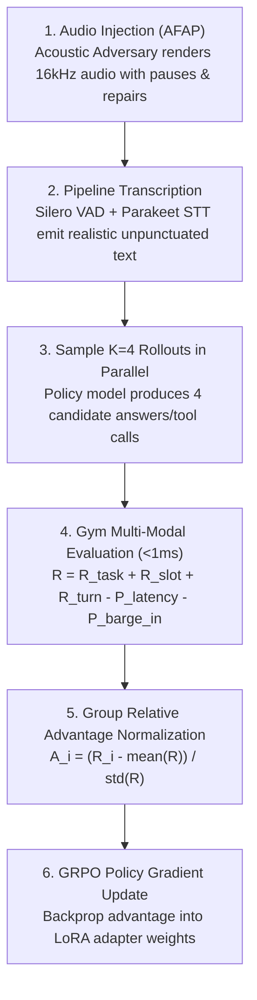

# Voice Pipes Gym

**Status:** active  
**Last verified:** 2026-10-23  
**Owner:** Core / Bench  

**Voice Pipes Gym** (`voice-pipes-gym`) is a native, ultra-low-latency reinforcement learning (RL) and automated evaluation environment for real-time conversational voice agents.

Unlike traditional text LLM gyms that rely on heavy Docker containers, external mock REST APIs, or synchronous Python orchestrators, Voice Pipes Gym is **100% native Rust**:
- **Microsecond resets**: `env.reset()` rolls back transactional in-memory state in under $30\mu\text{s}$, enabling thousands of rollouts per second without disk or network I/O.
- **Acoustic adversary**: Injects realistic speech disfluencies (*"um"*, *"uh"*), pauses, and mid-utterance self-corrections (*"Send 100 to checking... wait, make it 150 to savings"*).
- **Multi-modal reward function**: Evaluates verifiable task success, slot extraction precision, turn-taking etiquette, and penalizes latency ($>500\text{ms}$) and barge-in overrun ($>200\text{ms}$).
- **Zero external dependencies**: Built directly on `voice-pipes-sdk` with `#![forbid(unsafe_code)]`.

---

## 5-Minute Quickstart

### 1. Run the Standalone Rust Example

A runnable example is included in `voice-pipes-gym`:

```sh
cargo run -p voice-pipes-gym --example quickstart
```

This executable:
1. Instantiates a `BankingTaskEnv` with sample accounts.
2. Injects conversational hesitation and corrections using `AcousticAdversary`.
3. Executes a simulated voice agent tool call (`transfer_funds`).
4. Verifies the database state against `BankingGoal::Transfer`.
5. Computes the composite multi-modal reward breakdown.
6. Performs an instant in-memory rollback reset ($<30\mu\text{s}$).

### 2. Quickstart Code Snippet

```rust
use voice_pipes_gym::{
    AcousticAdversary, AdversaryConfig, BankingGoal, BankingTaskEnv,
    ClientToolCall, GymRewardBreakdown, GymRewardWeights, TaskEnvironment,
};

// 1. Initialize environment with default state
let mut env = BankingTaskEnv::new_default();

// 2. Perturb raw intent with realistic acoustic adversary
let adversary = AcousticAdversary::default();
let spoken_prompt = adversary.perturb_prompt("Transfer 250 dollars from checking to savings", 42);

// 3. Simulated agent executes tool call
let call = ClientToolCall::new(
    "call-1",
    "transfer_funds",
    serde_json::json!({
        "from_account": "checking",
        "to_account": "savings",
        "amount": 250.0
    }),
);
let tool_result = env.execute(&call).expect("tool execution succeeds");

// 4. Verify ground truth
let goal = BankingGoal::Transfer {
    from_account: "checking".to_string(),
    to_account: "savings".to_string(),
    expected_amount: 250.0,
};
let eval = env.verify_goal(&goal);
assert!(eval.success);

// 5. Compute composite reward
let weights = GymRewardWeights::default();
let reward = GymRewardBreakdown::compute(
    &weights,
    &eval,
    1.0,         // slot accuracy (100%)
    0.3,         // conversational cadence score
    Some(380.0), // 380ms TTFA (under 500ms budget)
    None,        // no barge-in interruption
);
println!("Composite Reward: {:.2}", reward.total_reward);

// 6. Reset in microseconds
env.reset();
```

---

## The Three Native Task Environments

Each environment implements the [`TaskEnvironment`](../../voice-pipes-gym/src/env.rs) trait, providing client-side tool specifications via `tools()`, execution via `execute()`, and deterministic rollback via `reset()`.

| Domain | Crate Module | Tools Exposed | Acoustic Challenge | Goal Verification |
|---|---|---|---|---|
| **Banking** | `voice_pipes_gym::banking` | `get_balance`, `transfer_funds`, `lock_card` | Mid-utterance corrections (*"Send 100... wait, 200"*) | Balance arithmetic & atomic rollback |
| **Order Support** | `voice_pipes_gym::orders` | `lookup_order`, `update_shipping_address`, `cancel_order` | Alphanumeric spelling & noise (*"Order B-4-8-2"*) | Casing preservation & shipping status check |
| **Clinic Booking** | `voice_pipes_gym::clinic` | `find_slots`, `book_appointment` | Multi-turn slot negotiation | Exact doctor/date/time reservation without double-booking |

### 1. Banking (`BankingTaskEnv`)
- **Default Accounts**: `checking` ($1,250.00), `savings` ($5,400.00), `credit` (-$320.00).
- **Cards**: Active card ending in `4829`.
- **Invariants**: Transfers fail with `insufficient_funds` if checking would become negative.

### 2. Order Support (`OrderSupportTaskEnv`)
- **Default Orders**: `B482` (Status: `processing`), `K901` (Status: `shipped`).
- **Invariants**: Address updates to order `K901` are rejected with `Cannot change address: order is already shipped`.

### 3. Clinic Appointments (`ClinicBookingTaskEnv`)
- **Schedules**: `Dr. Smith` (slots `10:00`, `14:00`), `Dr. Taylor` (slots `09:00`, `11:30`, `15:00`) on `2026-11-04`.
- **Invariants**: Once booked, a slot is removed; repeated bookings for the same time are rejected.

---

## Acoustic Adversary

Spoken dialogue is rarely pristine. Callers hesitate, mispronounce, change their minds mid-sentence, and interrupt. The [`AcousticAdversary`](../../voice-pipes-gym/src/adversary.rs) models these dynamics deterministically via an initial seed:

```rust
let adversary = AcousticAdversary::new(AdversaryConfig {
    hesitation_rate: 0.3,       // 30% probability of inserting "um", "uh", "let's see"
    self_correction_rate: 0.2,  // 20% probability of mid-utterance intent revision
    attempt_barge_in: true,     // trigger interruption while agent speaks
    barge_in_delay_ms: 450,     // wait 450ms into agent TTS before interrupting
});
```

---

## Multi-Modal Composite Reward Function

Traditional RL environments only score final state ($R_{\text{task}}$). Voice agents must simultaneously be evaluated for conversational etiquette, phonetic accuracy, and acoustic latency:

$$\mathcal{R} = R_{\text{task}} + R_{\text{slot}} + R_{\text{turn}} - P_{\text{latency}} - P_{\text{barge\_in}}$$

1. **$R_{\text{task}} \in \{0.0, 1.0\}$ (Outcome Reward)**:
   Verifiable database state mutation verified by `env.verify_goal()`.
2. **$R_{\text{slot}} \in [0.0, 1.0]$ (Perception Reward)**:
   Extraction accuracy of entity arguments (account names, dollar values, doctor names).
3. **$R_{\text{turn}} \in [-0.5, 0.5]$ (Etiquette Reward)**:
   Turn cadence score rewarding natural pauses and penalizing dead air or speaking over the user.
4. **$P_{\text{latency}} = \max(0, \text{TTFA} - 500\text{ms}) \times 0.002$**:
   Penalty assessed when Time-to-First-Audio exceeds the 500ms conversational budget.
5. **$P_{\text{barge\_in}} = \max(0, \text{Overrun} - 200\text{ms}) \times 0.005$**:
   Penalty assessed when the agent continues generating audio after the user starts speaking.

---

## Full Glass-to-Glass Audio Mode vs Fast Text Mode

Voice Pipes Gym supports two distinct evaluation modes:

```
Fast Mode (Text):
[ Caller Text with "um" ] ──────────────────────────────────────────► [ LLM Policy ] ──► [ Gym Tools ]

Full Glass-to-Glass Audio Mode (AFAP):
[ Synthetic Caller Audio ] ──► [ Silero VAD ] ──► [ Parakeet STT ] ──► [ LLM Policy ] ──► [ Gym Tools ] ──► [ Piper TTS ]
      (16kHz PCM)             (Speech onset/      (Noisy phonetic         (Decides       (Updates balance      (Streams audio
                              hesitation gaps)      transcript)          tool call)        in-memory)          to listener)
```

### Why Text-Only Evaluation Falls Short
Testing or training models on clean text is like training a pilot in a flight simulator without turbulence:
1. **Punctuation & Capitalization Artifacts**: Text benchmarks supply capitalized names and proper commas. Spoken STT outputs unpunctuated, lowercase text (`"send one hundred to checking wait make that two fifty to savings"`). Greedy models trained only on text often fail to parse spoken repairs.
2. **Acoustic & Phonetic Ambiguity**: Callers slur words, speak with background vehicle noise, or say phonetically confusable terms (*"for eighty two"* vs *"482"*, *"fifty"* vs *"fifteen"*).
3. **VAD Premature Cut-Offs**: When a caller says *"Transfer... [500ms pause]... 250 dollars"*, poorly tuned VADs commit prematurely, causing the agent to act on partial sentences. Full audio mode tests whether your VAD and turn-detector tolerate natural human thinking pauses.

---

## Faster-Than-Real-Time (AFAP) Simulation

In physical phone conversations, audio is bound to wall-clock time: a 5-second sentence takes 5.0 seconds to speak (**$1.0\times$ Real-Time Factor / RTF**).

However, **computers have no vocal cords**. Voice Pipes operates in **As-Fast-As-Possible (AFAP)** mode (`inject_speed = 0.0` in `voice-pipes-bench`). The models process incoming audio frames at their raw hardware inference speed without sleeping:

| Component | Real-Time Factor (RTF) | Wall-Clock Time to Process 5.0s of Audio |
|---|---|---|
| **Silero VAD** | `0.005` | **25 milliseconds** |
| **Parakeet TDT STT** | `0.020` | **100 milliseconds** |
| **Qwen 2.5 7B LLM** | (15 token tool call @ 200 tok/s) | **75 milliseconds** |
| **Piper TTS** | `0.015` | **75 milliseconds** |
| **Voice Pipes Gym State Machine** | `0.000005` | **25 microseconds** |
| **Total 10s Spoken Interaction** | **$\approx 0.025$** | **$\sim 275$ milliseconds!** |

> **Speedup:** A full 10-second spoken phone conversation finishes glass-to-glass in **under 300ms** (**$35\times$ to $40\times$ faster than real time**).

### What AFAP Means for Model Training:
At $40\times$ real-time speed, **10,000 simulated voice calls take only ~40 minutes** on a single workstation GPU (RTX 4090) instead of 28 hours.

---

## Full RL Model Training Loop (GRPO / DPO with LoRA)

### 1. Which Components Can We Train?

Voice Pipes Gym can be used to optimize three distinct layers of your voice stack:

#### Component A: The Conversational Policy LLM / SLM (Primary)
* **Target Models:** Open weights such as `Qwen/Qwen2.5-7B-Instruct`, `meta-llama/Llama-3.1-8B-Instruct`, or `SmolLM2-1.7B-Instruct` using LoRA (`peft`).
* **What the Model Learns:**
  1. **Spoken Brevity:** Standard LLMs write 60–100 word answers. The Gym rewards keeping answers between 10–20 words for natural spoken turn-taking.
  2. **Conversational Speech Repairs:** When a caller says *"Send $100 to checking... wait, cancel that, make it $250 to savings"*, standard models greedily bind `$100`. The Gym penalizes this and trains the model to resolve the self-correction to `$250`.
  3. **Zero Preamble:** Punishes useless filler phrases (*"Sure! I would be delighted to help you with that..."*) that blow past the 500ms TTFA budget.
  4. **Phonetic Ambiguity Tolerance:** Learns to execute tools accurately despite unpunctuated, noisy speech recognition transcripts.

#### Component B: End-to-End Speech-to-Speech (S2S) Models
* **Target Models:** Native audio-in/audio-out models (e.g. Mini-Omni, GLM-4-Voice).
* **What the Model Learns:** Direct acoustic turn-taking, optimal pause durations, and instant acoustic cut-off when barge-in audio is detected.

#### Component C: Turn-Taking & VAD Calibrators
* **Target Models:** `voice-pipes-turn-smart` and `voice-pipes-turn-vap` (Voice Activity Projection).
* **What It Learns:** Optimal silence detection thresholds ($300\text{ms}$–$600\text{ms}$) that distinguish between a caller pausing to think versus actually yielding the floor.

---

### 2. The Step-by-Step GRPO Training Algorithm

Group Relative Policy Optimization (**GRPO**) eliminates the need for a separate Critic / Value model by computing advantages across a group of $K$ candidate rollouts sampled for the same prompt:



#### Step 1: Adversarial Spoken Utterance Generation
The `AcousticAdversary` generates 16kHz PCM audio containing hesitations (*"um"*, *"uh"*) and mid-utterance changes of mind:
$$\text{Utterance: } \text{"send \$100 to checking... wait, make it \$250 to savings"}$$

#### Step 2: High-Speed AFAP Acoustic Ingestion
The audio frames are pushed through Silero VAD and Parakeet STT in AFAP mode ($40\times$ faster than real time), yielding the raw acoustic transcript:
$$\text{Transcript: } \text{"send 100 to checking wait make it 250 to savings"}$$

#### Step 3: Parallel Rollout Sampling ($K = 4$)
The policy model generates $K=4$ candidate tool calls and responses in parallel (via vLLM / Hugging Face with temperature $0.7$):
* **Rollout 1:** `transfer_funds(from="checking", to="savings", amount=250.0)` $\to$ *"Transferred $250 to savings."* (Concise, correct).
* **Rollout 2:** `transfer_funds(from="checking", to="savings", amount=100.0)` $\to$ *"Sent $100."* (Missed self-correction).
* **Rollout 3:** `transfer_funds(from="checking", to="savings", amount=250.0)` $\to$ (65-word long paragraph explaining bank policies).
* **Rollout 4:** Hallucinates nonexistent tool `send_cash_instantly()`.

#### Step 4: Multi-Modal Reward Scoring via Voice Pipes Gym
The Gym evaluates all $K$ rollouts in microseconds against ground truth:
$$\mathcal{R} = R_{\text{task}} + R_{\text{slot}} + R_{\text{turn}} - P_{\text{latency}} - P_{\text{barge\_in}}$$

* **Rollout 1:** $\mathcal{R}_1 = +1.56$ (Task OK $+1.0$, Slots OK $+0.5$, Turn OK $+0.06$, TTFA Penalty $0.00$)
* **Rollout 2:** $\mathcal{R}_2 = +0.06$ (Task Failed $0.0$, Missed repair, Turn OK $+0.06$)
* **Rollout 3:** $\mathcal{R}_3 = +1.12$ (Task OK $+1.0$, Slots OK $+0.5$, TTFA Penalty $-0.34$, Verbose Turn $-0.04$)
* **Rollout 4:** $\mathcal{R}_4 = +0.06$ (Invalid tool call)

#### Step 5: Group Relative Advantage Normalization
GRPO computes the relative advantage $A_i$ of each candidate within its group:
$$\mu = \frac{1}{K} \sum_{i=1}^K \mathcal{R}_i = 0.70, \quad \sigma = \text{std}(\mathcal{R}) = 0.65$$
$$A_i = \frac{\mathcal{R}_i - \mu}{\sigma + \epsilon}$$

* **Candidate 1:** $A_1 = \mathbf{+1.31}$ (High positive advantage — model strongly reinforced!)
* **Candidate 2:** $A_2 = \mathbf{-0.97}$ (Negative advantage — penalized for transferring wrong amount)
* **Candidate 3:** $A_3 = \mathbf{+0.64}$ (Positive task completion, but lower advantage due to verbosity penalty)
* **Candidate 4:** $A_4 = \mathbf{-0.97}$ (Negative advantage — penalized for hallucination)

#### Step 6: Clipped Policy Gradient Loss Update
The model updates its LoRA adapter weights using the standard clipped surrogate objective:
$$\mathcal{L}_{\text{GRPO}}(\theta) = - \frac{1}{K} \sum_{i=1}^K \min\left( \frac{\pi_\theta(o_i|q)}{\pi_{\text{old}}(o_i|q)} A_i, \text{clip}\left( \frac{\pi_\theta(o_i|q)}{\pi_{\text{old}}(o_i|q)}, 1-\epsilon, 1+\epsilon \right) A_i \right) + \beta D_{\text{KL}}(\pi_\theta \parallel \pi_{\text{ref}})$$

---

### 3. Reference Python Training Script

A runnable reference training loop is included in [`scripts/train_gym_grpo.py`](../../scripts/train_gym_grpo.py):

```sh
python scripts/train_gym_grpo.py
```

This script connects the sampling loop, WebSocket AFAP audio ingestion, Voice Pipes Gym reward evaluation, and GRPO advantage normalization on workstation hardware.

---

## Running Benchmarks with Voice Pipes Gym

The pre-configured test suite [`voice-pipes-bench/examples/benchmark/gym-suite.json`](../../voice-pipes-bench/examples/benchmark/gym-suite.json) defines automated evaluations across all three domains.

### 1. Launch a Local Pipeline Worker

Start a local worker running Parakeet STT, Qwen 2.5 LLM, and Piper TTS:

```sh
voice-pipes --config examples/bench/bench-gym.toml serve
```

### 2. Execute the Gym Benchmark Suite

Post the experiment to the orchestrator:

```sh
curl -X POST http://127.0.0.1:8800/api/v1/benchmark/experiments \
  -H "Content-Type: application/json" \
  -d @voice-pipes-bench/examples/benchmark/gym-suite.json
```

Trigger the run:

```sh
curl -X POST http://127.0.0.1:8800/api/v1/benchmark/experiments/suite-gym-native/run
```

Each scenario connects over WebSocket, advertises the environment's tools, drives the adversarial conversation, executes tool calls in memory, and returns an itemized `GymResult` with latency percentiles and composite scores.
