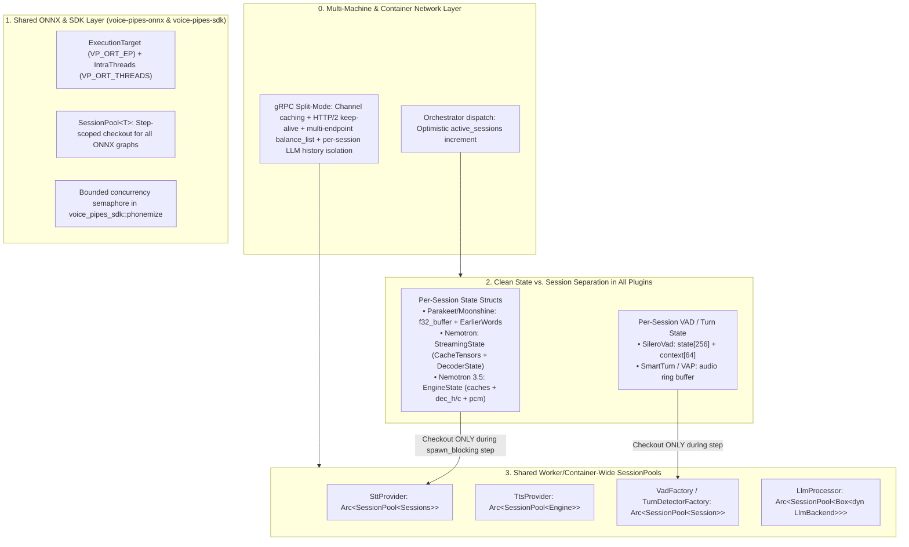
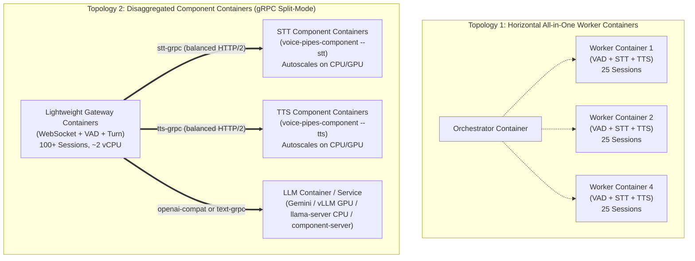

# Clean Architectural Plan: Scaling Voice Pipes to 100+ Concurrent Sessions (Single-Node, Multi-Machine, and Containerized Cloud Microservices)

**Status:** In Progress  
**Target Branch:** `feat/high-density-cpu-scaling`  
**Last updated:** 2026-11-10  
**Owner:** Core Engine, Shared Infrastructure (`voice-pipes-onnx`, `voice-pipes-sdk`), Local Inference Plugins, Orchestrator & gRPC Split Mode  

---

This plan makes **100+ concurrent sessions on CPU machines—and linear horizontal scaling across $N$ machines or cloud containers**—work cleanly across **any combination of STT, TTS, VAD, Turn Detection, Audio Filter, and LLM/S2S components** (Cloud LLMs, GPU LLMs, or CPU LLMs), without hardcoding or workarounds.

---

## Part 1: Architectural Root Causes Across All Component & Deployment Types

An audit of all 21 plugins, the transport layer, the orchestrator, and the `voice-pipes-component` gRPC container split-mode layer reveals **seven structural issues**:

| # | Structural Issue | Affected Crates / Files | Why It Breaks at Scale / in Cloud Containers |
| :--- | :--- | :--- | :--- |
| **P1** | **Streaming STT couples per-stream Rust state with the pooled ONNX `Sessions` object** | • `plugins/stt/parakeet/src/lib.rs` • `plugins/stt/moonshine/src/lib.rs` • `plugins/stt/nemotron/src/streaming.rs` • `plugins/stt/nemotron35/src/engine.rs` | Every ONNX `Session` in the workspace is **stateless** (weights + arena only). All streaming state (`f32_buffer`, `CacheTensors`, `DecoderState`, `dec_h`/`dec_c`) lives in plain Rust `Vec`/`HashMap` structs. Yet `StreamingEngine` (`nemotron`) and `Engine<S>` (`nemotron35`) own `PooledSlot<Sessions>` for the entire lifetime of `transcribe_stream` (and `parakeet`/`moonshine` check out `PooledSlot` before the `while` loop). Whether running in-process or inside an STT container (`voice-pipes/src/grpc/stt_server.rs`), 100 active sessions require 100 simultaneous pool slots (65–250 GB RAM) or fail after 5s with `PoolExhausted`. |
| **P2** | **Per-session factories (`VadFactory`, `TurnDetectorFactory`) reload `.onnx` files from disk on every WebSocket connect** | • `plugins/vad/silero/src/lib.rs` • `plugins/turn/smart/src/lib.rs` • `plugins/turn/vap/src/detector.rs` | `setup_audio_pipeline` (`voice-pipes/src/transport/serve/setup.rs`) calls `build_vad` and `build_turn_detector` on every WebSocket connection. Because `SileroVad`, `SmartTurnDetector`, and `VapTurnDetector` embed their `ort::session::Session` directly inside the per-session struct instead of checking out from a factory-owned `SessionPool`, 100 connections load the `.onnx` files from disk 100 times and allocate 100 duplicate ONNX sessions. |
| **P3** | **No unified `threads` (`intra_op_num_threads`) configuration across ONNX plugins** | • `voice-pipes-onnx/src/session.rs` • `plugins/stt/parakeet/src/lib.rs`, `plugins/tts/piper/src/engine.rs`, `plugins/tts/kokoro/src/engine.rs`, `plugins/turn/smart/src/lib.rs` | `parakeet`, `piper`, and `kokoro` hardcode `4` intra-op threads and have no `threads` config option, nor does `voice-pipes-onnx` support a process-wide `VP_ORT_THREADS` env var (unlike `VP_ORT_EP`). At 100 sessions, 25 concurrent inferences × 4 threads = 100+ compute threads thrashing CPU cores (especially fatal inside CPU-limited containers). |
| **P4** | **Unbounded `espeak-ng` subprocess spawning in `voice-pipes-sdk::phonemize`** | • `voice-pipes-sdk/src/phonemize.rs` | Each `phonemize()` call spawns an `espeak-ng` process + 2 OS threads (`writer` and `waiter`) with no concurrency bound. Under 100-session turn bursts, dozens of simultaneous `espeak-ng` processes and OS threads launch at once. |
| **P5** | **`voice-pipes-llm-gguf` wraps a single `Mutex<Box<dyn LlmBackend>>` instead of a `SessionPool`** | • `plugins/llm/gguf/src/lib.rs` | All sessions on a worker (or `voice-pipes-component` LLM container) using native `llm-gguf` serialize behind a single mutex (`pool_size = 1`), preventing parallel turn generation. |
| **P6** | **Orchestrator `GET /api/v1/dispatch` uses stale heartbeat counts between heartbeats (Multi-Machine/Container Thundering Herd)** | • `voice-pipes/src/api/orchestrator/handlers.rs` | `least-connections` dispatch reads `w.capacity.active_sessions`, which only updates on periodic worker heartbeats (`every 5–10s`). A burst of 50 clients within 1 second routes all 50 to the exact same worker container before its next heartbeat arrives. |
| **P7** | **Container Split-Mode (`grpc`) Bugs: Shared LLM History Bleed, Blocking Connect on Handshake, and Missing HTTP/2 Keep-Alive / Load Balancing** | • `voice-pipes/src/bin/component_server.rs` • `voice-pipes/src/text/grpc.rs` • `voice-pipes/src/grpc/client.rs` | **1.** `component_server.rs` builds **one** `Arc<dyn TextProcessor>` at startup; when serving an LLM over `type = "grpc"`, all 100 sessions share and corrupt the same single `ConversationMemoryWrapper` history! **2.** `GrpcTextProcessorFactory::build` runs on every WebSocket handshake and calls `block_in_place(GrpcTextProcessor::connect)`, opening a new TCP socket + `GetInfo` RPC per session. **3.** `grpc::client::connect` sets no HTTP/2 keep-alive (causing cloud NAT/CNI idle drops) and connects to a single TCP endpoint instead of balancing across container replicas. |

---

## Part 2: Clean Architectural Modifications

### Modification 1: Clean Separation of Per-Stream State and Pooled ONNX Sessions in **All 4 Local STT Plugins**
Every local STT plugin (whether running in-process on a worker or inside a dedicated `voice-pipes-component` STT container) will follow **one uniform architectural pattern**:
* **The `transcribe_stream` task owns only the lightweight per-session Rust state.**
* **The `SessionPool` owns the heavyweight, stateless ONNX `Session` graphs.**
* **A `PooledSlot` is checked out *only* when enough audio is buffered to execute an actual `spawn_blocking` inference pass, and is dropped immediately when `spawn_blocking` returns.**

Specifically:
1. **`voice-pipes-stt-parakeet` & `voice-pipes-stt-moonshine`:**
   * Remove the stream-long `self.pool.checkout()` at the top of `transcribe_stream`.
   * Check out `self.pool.checkout_within(...)` right before `tokio::task::spawn_blocking` on each decode pass (and rescue pass in Parakeet) and drop it immediately after `spawn_blocking` returns.
2. **`voice-pipes-stt-nemotron`:**
   * Split `StreamingEngine` cleanly into:
     * `StreamingState`: owns `cache: CacheTensors`, `decoder_state: DecoderState`, `sample_buffer: Vec<f32>`, `left_context_samples: Vec<f32>`, and `chunks_processed: usize`.
     * `NemotronSessions`: owns `encoder: Session`, `decoder: Session`, `joint: Session`.
   * Add `StreamingState::can_step(&self) -> bool` (checks if `sample_buffer.len() >= first_step_samples` or `step_samples`).
   * In `NemotronStt::transcribe_stream`: append incoming 20ms chunks to `state.push_samples(&samples)` in the async loop. Only when `state.can_step() || is_final` is true, check out a `PooledSlot<NemotronSessions>`, run `state.step_and_flush(&mut slot, is_final)` in `spawn_blocking`, and immediately drop `slot` back to the pool.
3. **`voice-pipes-stt-nemotron35`:**
   * Decouple `Engine` from owning `sessions: S`. Make `Engine` a pure state struct (`caches`, `cache_valid`, `dec_h`, `dec_c`, `dec_out`, `pcm`, `pcm_start`, `mel_idx`, `started`, `tokens`, `tags_seen`, `chunks_run`) whose methods (`prime(&mut self, sessions: &mut Sessions)`, `accept(&mut self, sessions: &mut Sessions, samples: &[f32])`, `end_utterance(&mut self, sessions: &mut Sessions)`) take `&mut Sessions`.
   * Add `Engine::has_pending_chunk(&self) -> bool` so `Nemotron35Stt::transcribe_stream` buffers incoming 20ms audio in `engine` and only checks out `PooledSlot<Sessions>` and calls `spawn_blocking` when a full 320ms chunk is ready or `is_final` is true.

### Modification 2: First-Class `SessionPool` in `SileroVadFactory`, `SmartTurnFactory`, and `VapTurnFactory`
Instead of loading `.onnx` files from disk on every WebSocket handshake in `setup_audio_pipeline`:
* **`voice-pipes-vad-silero`:**
   * Give `SileroVadFactory` an internal cache of `Arc<SessionPool<Session>>` (keyed by model path and options, with configurable `pool_size` and `threads` in `[vad.options]`).
   * In `OrtSilero::step`, check out a session from the pool for the 150 µs `session.run(...)` call, keeping `state: Vec<f32>` (`[2, 1, 128]`) and `context: Vec<f32>` (`[64]`) on the per-session `SileroVad` struct.
* **`voice-pipes-turn-smart` & `voice-pipes-turn-vap`:**
   * Replace the per-session `Arc<Mutex<Box<dyn CompletionModel>>>` with a factory-managed `Arc<SessionPool<OnnxModel>>` (configurable via `smart_pool_size` / `smart_threads` and `vap_pool_size` / `vap_threads` in `[turn_detection]`).
   * Run the startup Whisper/VAP shape validation probe **once** when the pool is constructed instead of on every WebSocket connect.

### Modification 3: First-Class Thread & Pool Configuration in `voice-pipes-onnx` and All Local Plugins
* Add `pub const INTRA_THREADS_VAR: &str = "VP_ORT_THREADS";` and `SessionOptions::from_env_or(default_threads: usize) -> Self` in `voice-pipes-onnx/src/session.rs`.
* Ensure all local ONNX plugins (`parakeet-tdt`, `moonshine`, `nemotron`, `nemotron-3.5`, `piper`, `kokoro`, `silero`, `smart`, `vap`) support `threads` and `pool_size` (`1..=128`) in their config options and schema.

### Modification 4: Bounded Subprocess Concurrency in `voice-pipes-sdk::phonemize`
* Add a process-wide concurrency limiter (`VP_PHONEMIZE_JOBS`, defaulting to `max(16, available_parallelism() * 2)`) inside `voice-pipes-sdk/src/phonemize.rs` around `espeak-ng` process spawning.

### Modification 5: `SessionPool` Support in `voice-pipes-llm-gguf`
* Replace `backend: Arc<Mutex<Box<dyn LlmBackend>>>` in `LlmProcessor` with `pool: Arc<SessionPool<Box<dyn LlmBackend>>>` and add `pool_size` (`1..=32`, default `1`) to `GgufOptions` and `schema.rs`.

### Modification 6: Optimistic Admission Accounting in Orchestrator `dispatch`
* In `voice-pipes/src/api/orchestrator/handlers.rs`, optimistically increment `w.capacity.active_sessions += 1` when `GET /api/v1/dispatch` selects a worker (reconciled on the next worker heartbeat/session event) and use an atomic counter for `round-robin` so simultaneous client bursts distribute evenly across all worker containers/machines.

### Modification 7: Cloud Container & gRPC Split-Mode Hardening (`grpc/client.rs`, `text/grpc.rs`, `bin/component_server.rs`)
To make separate cloud containers for STT, TTS, and LLM work seamlessly at 100+ sessions:
1. **HTTP/2 Keep-Alive & Multi-Endpoint Balancing in `voice-pipes/src/grpc/client.rs`:**
   * Configure `.http2_keep_alive_interval(Duration::from_secs(15))`, `.keep_alive_timeout(Duration::from_secs(5))`, `.keep_alive_while_idle(true)`, and `.tcp_keepalive(Some(Duration::from_secs(15)))` on all gRPC client channels so cloud VPC NATs / container bridges never drop idle inter-container streams.
   * Support comma-separated endpoints in `endpoint` (e.g. `endpoint = "http://stt-1:50051,http://stt-2:50051"`) using `Channel::balance_list` so a gateway container load-balances RPCs across multiple component containers out of the box without needing an Envoy/Linkerd service mesh.
2. **Cache the Shared gRPC Channel in `GrpcTextProcessorFactory`:**
   * Cache the connected `GrpcTextProcessor` channel per endpoint inside `GrpcTextProcessorFactory` instead of calling `block_in_place(GrpcTextProcessor::connect)` on every WebSocket handshake.
3. **Per-Session History Isolation in `voice-pipes-component` Text Server (`grpc/text_server.rs` & `bin/component_server.rs`):**
   * Instead of wrapping a single `Arc<dyn TextProcessor>` (which shares one `ConversationMemoryWrapper` across all 100 sessions!), `GrpcTextProcessor` will own a unique `session_id` per `build()` instance and pass it in gRPC request metadata (`x-vp-session-id`), while `TextProcessorServiceImpl` builds/caches a per-session `TextProcessor` instance (reusing the shared model weights via `load_shared`!) and cleans it up when `ResetConversation` is called or after an idle TTL.

---

## Part 3: Cloud Container & Multi-Machine Topologies (100 → 1,000+ Sessions)

With Modifications 1–7, you can deploy in **either** of two cloud container patterns:

### Container-Specific Rules We Will Document:
1. **Explicit `VP_ORT_THREADS` Inside Containers:** Always set `VP_ORT_THREADS=1` or `2` (or `threads = 2` in TOML) in container manifests (`Dockerfile` / Kubernetes `env`) so ONNX Runtime never inspects the host node's 64 physical cores when the container has a 4-vCPU cgroup limit.
2. **Container Image Dependencies:** Only TTS containers running `piper` or `kokoro` need `espeak-ng` installed; gateway containers (`stt-grpc`, `tts-grpc`) need no local `.onnx` weights or `espeak-ng`.
3. **Kubernetes / ECS Load Balancing for gRPC Split Mode:** Either pass comma-separated container endpoints (`endpoint = "http://stt-0.stt:50051,http://stt-1.stt:50051"`) to use `Channel::balance_list` (Mod 7), or use an L7 gRPC proxy, because standard Kubernetes ClusterIP Services balance at L4 (per TCP connection) rather than per HTTP/2 stream.

---

## Part 4: Documentation & Verification Plan

1. **Create `docs/guides/high-density-cpu-deployment.md` (and link in `docs/SUMMARY.md`):**
   * Universal capacity-sizing formulas (`pool_size`, `threads`, vCPU, RAM, network bandwidth).
   * Full 21-plugin CPU/RAM/configuration reference table.
   * Blueprints for:
     1. Single-machine & Multi-machine worker fleets.
     2. Disaggregated Cloud Containers (`voice-pipes-component` gRPC split mode for STT, TTS, and LLM).
     3. Cloud LLM (Gemini/OpenAI) vs. Self-Hosted GPU LLM (vLLM/SGLang/`llama-server`) vs. Self-Hosted CPU LLM (NUMA-pinned `llama-server` / `voice-pipes-component`).
2. **Update `docs/extending/plugin-sdk.md`, `docs/extending/grpc-split-mode.md`, `docs/reference/config.md`, Provider Guides, and `AGENTS.md`.**
3. **Unit, Concurrency, & Workspace Verification:**
   * Multi-session concurrency tests (`pool_size = 2` serving `16` concurrent streams) across `parakeet`, `moonshine`, `nemotron`, `nemotron35`.
   * Shared pool & concurrency tests in `silero`, `smart`, `vap`, `llm-gguf`.
   * Orchestrator optimistic dispatch test & gRPC split-mode per-session LLM history isolation test.
   * Pass `cargo check --workspace`, `cargo clippy --workspace -- -D warnings`, `cargo test --workspace`, and `cargo test -p voice-pipes-cli --test workspace_rules`.
