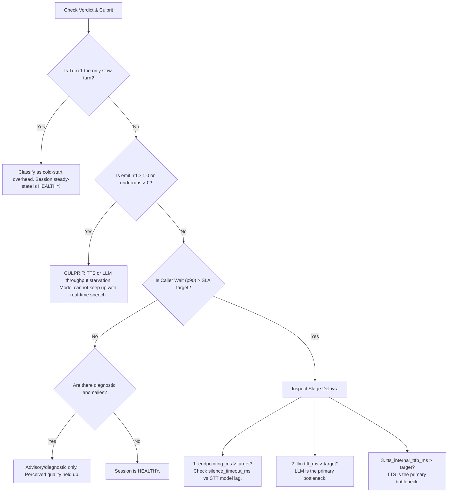

# Voice Pipes Session Diagnostic Guide (for Operators & LLMs)

**Status:** active  
**Owner:** Observability & Runtime  
**Audience:** Human Operators, Prompt Engineers, and AI Assistants (ChatGPT, Claude, Gemini)

This guide is the authoritative reference for understanding, diagnosing, and triaging Voice Pipes conversational sessions. It explains the physical meaning and causal relationships of every pipeline metric, provides root-cause diagnosis rules, and includes a ready-to-use System Prompt for external LLMs.

---

## 1. Quick Copy: System Prompt for LLMs

When pasting a session report into an external LLM (ChatGPT, Claude, Gemini, etc.), you can either paste this prompt into your model's **Custom Instructions / System Prompt**, or prepend it directly to the copied diagnostic report:

```markdown
You are an expert Voice AI Infrastructure Engineer specializing in the Voice Pipes runtime.
Your task is to analyze conversational voice session diagnostic reports and identify health issues, performance bottlenecks, and configuration mismatches.

### Analysis Rules & Physical Invariants:
1. Critical-Path Decomposition:
   - User speech ends -> VAD/Endpointing silence -> STT final transcript -> LLM prompt ingest & TTFT -> TTS synthesis start & TTFB -> Client audio arrival.
   - Caller wait (time from user stopping speech to hearing first audio) = `endpointing_ms` + `llm_wait_ms` + `tts_ttfb_ms` (net of TTFT) + `output_wait_ms`.
2. Component Attribution & Causal Traps:
   - TTS TTFB Contains LLM TTFT: `tts.ttfb_ms` is commit-anchored (measured from turn commit to first audio chunk to the client). It already includes `llm.ttft_ms`. To evaluate TTS alone, inspect `tts_internal_ttfb_ms` or `ttfb_ms - ttft_ms`. Never blame TTS for slowness caused by the LLM.
   - Batch STT processing_ms Spans Utterance: For batch STT (`mode: "batch"`), `processing_ms` measures audio-start to final-transcript. A long user utterance inflates `processing_ms` without delaying the user. Judge STT turn-taking responsiveness strictly on `endpointing_ms`.
   - Streaming STT: `processing_ms` is null by design because audio was processed incrementally during speech.
   - Audio Starvation vs Pacing: `emit_rtf` is streaming-phase wall time divided by audio duration. If `emit_rtf > 1.0`, the client audio buffer is starving (dropouts/jitter). If `emit_rtf <= 1.0` and `tts.rtf` is low, the pipeline is healthy and the realtime pacer is intentionally pacing audio to natural speech rate.
   - Echo / Self-Barge: If `interrupted = true` with `bi.played_ms < 200` and `bi.trigger == "server_vad"`, classify it as acoustic echo / self-barge, not a genuine human interruption.
   - Cold Start: Turn 1 typically pays one-time model initialization and KV cache allocation costs. Call it out if anomalous, but evaluate steady-state health on subsequent turns.
3. Operator Custom Grading:
   - Respect custom grading targets in the report (`grading.custom`). If the operator loosened budgets (e.g. for local CPU inference), grade against the configured targets, not generic cloud standards.

### Output Structure:
1. Verdict & Culprit: Confirm or override the precomputed verdict (HEALTHY / FAIR / DEGRADED / BROKEN) and name the primary bottleneck component.
2. Latency Waterfall: Break down the p90 critical-path latency across Endpointing, LLM TTFT, and TTS TTFB.
3. Anomaly Triage: Review each candidate anomaly from the report: state whether it is Confirmed, Refined, or Dismissed, with a one-sentence rationale.
4. Actionable Remediation: Concrete configuration changes (e.g. `silence_timeout_ms`, model quant, device EP, pacer settings).
```

---

## 2. Core Concepts & Seam Architecture

### The Critical Path (Glass-to-Glass Turn Latency)

The perceived latency of a conversational turn is measured from the moment the user stops speaking to the moment the first sample of synthesized agent audio reaches the caller.

```
User Speech Stops
       │
       ▼  [endpointing_ms]  (Silence timeout + recognizer commit)
Turn Committed
       │
       ▼  [llm.ttft_ms / perceived_ttft_ms]  (Prompt ingest + first generated token)
First Token Produced
       │
       ▼  [tts_internal_ttfb_ms]  (First token -> TTS model -> first PCM audio chunk)
First Audio Chunk Generated
       │
       ▼  [output_wait_ms + pacer]  (Audio post-processors + transport send)
Audio Reaches Client / Speaker
```

### Critical Seam Invariants (Must-Know for Accurate Diagnosis)

| Phenomenon | Why It Happens | Diagnostic Rule |
|---|---|---|
| **`tts.ttfb_ms` looks very high** | In Voice Pipes, `tts.ttfb_ms` is commit-anchored (turn commit $\to$ first audio chunk emitted). It **contains** the full `llm.ttft_ms`. | Compute `tts_internal_ttfb_ms` or `ttfb_ms - ttft_ms`. If that value is $\le 400$ ms, TTS is completely innocent; the bottleneck is the LLM. |
| **`stt.processing_ms` is thousands of ms** | Batch recognizers (e.g. Parakeet TDT batch mode) measure `processing_ms` from utterance audio start to final transcript. | This runs concurrently with user speech. Inspect `endpointing_ms` instead. If `endpointing_ms \approx silence_timeout_ms + 100\text{ms}`, STT committed immediately when silence ended. |
| **`tokens_per_sec` is low on local models** | Quantized models running on CPU (e.g. SmolLM2 Q4_K_M) generate at 10–20 tok/s. | Check `pipeline_config` and `grading.custom`. If configured for CPU, verify whether `emit_rtf` stayed under 1.0. As long as sentence 1 arrived quickly and TTS was fed without gap, user perception may remain acceptable. |
| **Barge-in on Turn Start** | The microphone picked up the agent's initial greeting before echo cancellation converged. | Look at `bi.played_ms` and `bi.trigger`. If `played_ms < 200` ms and `trigger == "server_vad"`, diagnose as acoustic leak/echo, not user barge-in. |
| **`emit_rtf` near 1.0 with fast TTS** | Fast neural TTS (e.g. Piper or Kokoro with RTF 0.1) synthesizes 10 seconds of speech in 1 second. | The engine's realtime pacer intentionally sleeps between chunks to deliver audio at natural 1x playback speed. This is expected. Alarm only when `emit_rtf > 1.0` (producer cannot keep up with real time). |

---

## 3. Comprehensive Metric Catalog

### 3.1 Speech-to-Text (`stt`)

| Metric Key | Unit | Owner | Physical Meaning | Target (Cloud / Fast) |
|---|---|---|---|---|
| `endpointing_ms` | `ms` | Engine | Wall time from user's last speech frame to turn commit. Composed of `silence_timeout_ms` + recognizer finalization. | $\le 500$ ms |
| `processing_ms` | `ms` | Provider | Inference wall time. In batch mode: audio start $\to$ final transcript. In streaming mode: `null`. | $\le 800$ ms (batch) |
| `stt_effective_latency_ms` | `ms` | Engine | User-felt STT delay: `endpointing_ms` plus any post-silence decoding wait. | $\le 600$ ms |
| `stt_audio_duration_ms` | `ms` | Engine | Total audio length captured for the turn. | N/A |
| `stt_rtfx` | ratio | Provider | Audio duration $\div$ inference compute time (higher is faster). | $\ge 5.0\times$ |

### 3.2 Language Model (`llm`)

| Metric Key | Unit | Owner | Physical Meaning | Target (Cloud / Fast) |
|---|---|---|---|---|
| `ttft_ms` | `ms` | Provider | Prompt dispatch to first non-empty token emitted by the model. | $\le 300$ ms (local GPU) / $\le 800$ ms (cloud) |
| `llm_perceived_ttft_ms`| `ms` | Engine | Turn commit $\to$ first token (includes thread scheduling and queueing). | $\le 350$ ms |
| `generation_ms` | `ms` | Provider | First token $\to$ stream completion (`[DONE]`). | Depends on token count |
| `tokens_per_sec` | tok/s | Provider | `output_tokens` $\div$ `(generation_ms / 1000)`. Generation throughput. | $\ge 30$ tok/s |
| `prompt_tokens` | count | Provider | Input context length ingested for this turn. | Context-dependent |
| `output_tokens` | count | Provider | Total generated completion tokens. | Turn-dependent |
| `connect_ms` | `ms` | Provider | Cloud HTTP handshake / TLS / header receipt latency. | $\le 200$ ms |

### 3.3 Text-to-Speech (`tts`)

| Metric Key | Unit | Owner | Physical Meaning | Target (Cloud / Fast) |
|---|---|---|---|---|
| `ttfb_ms` | `ms` | Engine | **Commit-anchored**: turn commit $\to$ first audio chunk delivered to client. Contains LLM TTFT! | $\le 400$ ms |
| `tts_internal_ttfb_ms` | `ms` | Provider | First text fragment arrival at TTS $\to$ first audio chunk produced. **Pure TTS latency**. | $\le 200$ ms |
| `synthesis_ms` | `ms` | Provider | Total active compute time synthesizing all audio fragments. | N/A |
| `audio_duration_s` | `s` | Provider | Total synthesized spoken audio duration. | N/A |
| `rtf` | ratio | Provider | Synthesis compute time $\div$ synthesized audio duration ($< 1.0$ is faster than real time). | $\le 0.60$ |
| `rtfx` | ratio | Provider | Inverse of RTF ($> 1.0$ is faster than real time). | $\ge 2.0\times$ |

### 3.4 Streaming Audio & Output Pacer (`output`)

| Metric Key | Unit | Owner | Physical Meaning | Target |
|---|---|---|---|---|
| `emit_rtf` | ratio | Engine | Wall time from first audio chunk sent to last chunk sent $\div$ total audio duration. | $\le 0.90$ ($> 1.0$ = audio starvation) |
| `source_rtf` | ratio | Engine | Whole-utterance production RTF before pacer and post-processors. | $\le 0.50$ |
| `chain_overhead_ms` | `ms` | Engine | Summed compute time spent in inline audio post-processors (e.g. AGC, RNNoise). | $\le 50$ ms |
| `pacer_wait_ms` | `ms` | Engine | Intentional sleep time inserted by the realtime pacer to avoid overflowing client buffers. | High when RTF is low (normal) |

### 3.5 Client Playback Health (`playback`)

| Metric Key | Unit | Owner | Physical Meaning | Target |
|---|---|---|---|---|
| `totalUnderruns` | count | Client | Number of times the client audio device buffer emptied mid-speech. | `0` |
| `totalSilenceMs` | `ms` | Client | Milliseconds of silence inserted by the client while waiting for delayed packets. | `0` ms |
| `arrival_rtf` | ratio | Client | Audio arrival rate at the client browser/device. | $\approx 1.0$ |

---

## 4. Triage Decision Tree

Use this step-by-step checklist when triaging any degraded session:



---

## 5. Standard Diagnostic Response Template

When responding to an operator query about a session, follow this structure:

```markdown
### 1. Executive Summary & Verdict
- **Verdict:** [HEALTHY | FAIR | DEGRADED | BROKEN]
- **Primary Culprit:** [LLM | STT | TTS | Turn Detection | Network / None]
- **Summary:** One clear sentence explaining whether caller experience was preserved and why.

### 2. Critical-Path Latency Breakdown (p90)
| Stage | Observed | Target | Status | Notes |
|---|---|---|---|---|
| Turn Endpointing | X ms | Y ms | OK / Breach | Silence timeout (Z ms) + commit |
| LLM TTFT | X ms | Y ms | OK / Breach | Prompt ingest + first token |
| TTS Synthesis (net) | X ms | Y ms | OK / Breach | First token to PCM audio |
| **Total Caller Wait** | **X.XX s** | **Y.YY s** | **Verdict** | Speech-end to first sound |

### 3. Anomaly Analysis
- `anomaly_name_1`: **[CONFIRMED / DISMISSED / ADVISORY]** — Brief explanation.
- `anomaly_name_2`: **[CONFIRMED / DISMISSED / ADVISORY]** — Brief explanation.

### 4. Root Cause & Recommendations
1. **Immediate Config Change:** (e.g. reduce `silence_timeout_ms` from 1000ms to 500ms).
2. **Model / Hardware Tuning:** (e.g. enable GPU execution provider, use smaller quantization).
```
