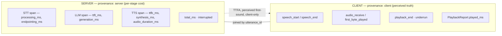

# VPO‑Metrics — Voice Pipeline Open Standard, Layer 1
## Canonical Metric Taxonomy & SLOs — Specification v0.1 (Draft)

> **Status:** Draft v0.1. This is the normative specification for Layer 1 of the Voice Pipeline
> Open Standard (VPO), paired with [VPO-Telemetry (Layer 2)](vpo-telemetry.md),
> [VPO-Protocol (Layer 3)](vpo-protocol.md), the machine-readable OpenTelemetry schema
> [`vpo-semconv.yaml`](vpo-semconv.yaml), and the implementation-level
> [Metrics glossary](metrics-glossary.md). It is intended to be adoptable standalone: a team on
> *any* decomposed STT→LLM→TTS or speech-to-speech voice stack can adopt these names, units, and
> definitions without changing their runtime.
>
> **Conformance language.** The key words **MUST**, **MUST NOT**, **SHOULD**, **SHOULD NOT**,
> and **MAY** are to be interpreted as in RFC 2119.
>
> **Reference implementation.** Every type, field, and unit named here exists in the reference
> engine: `src/pipeline/metrics.rs` (`TurnMetricsSnapshot`, `TurnComponentMetrics`,
> `ComponentMetricDescriptor`, `MetricUnit`), `src/transport/mod.rs` (`TimingEventKind`,
> `ClientControl::TimingReport`/`PlaybackReport`, `ServerControl::SessionSummary`,
> `ConnectionQuality`), and `src/component/mod.rs` (`Component::turn_descriptor`).

---

## 1. Scope & goals

### 1.1 What this layer defines
1. A **metric model** — how a metric is described (name, unit, provenance, kind) so that new
   metrics are typed but never require a schema migration.
2. A **provenance split** — which metrics MUST come from the **client** and which from the
   **server**, because neither side can observe the other's truth.
3. A **canonical catalog** — normative names, units, and precise measurement definitions for the
   STT, LLM, TTS, VAD, and Realtime-S2S stages.
4. **Derived KPIs** — cross-stage metrics (TTFA, perceived E2E latency, barge-in RTT, underrun
   rate, RTF) with exact formulas and their required inputs.
5. **SLOs** — a reference latency budget and tail targets with conformance thresholds.

### 1.2 What this layer does NOT define
- The wire protocol (Layer 3, VPO-Protocol) — though §6 references the transport carriers.
- The event stream / turn lifecycle (Layer 2, VPO-Telemetry).
- Storage, rollup, or UI rendering — those consume this taxonomy but are out of scope here.

### 1.3 Non-negotiable principles
- **Correlation-first.** Every metric in a turn is joined by a single `utterance_id`. A metric
  that cannot be attributed to an utterance is out of scope for this spec.
- **Extensible-but-typed.** The catalog is closed for *names and meanings* but open for
  *additions* via the descriptor + `extras` mechanism (§3). A vendor MUST NOT redefine a
  canonical key to mean something else.
- **Truthful provenance.** A metric MUST be labelled with where it was measured. Server-side
  estimates of client-perceived values (e.g. "perceived latency") are non-conformant; perceived
  values MUST originate client-side.

---

## 2. Core concepts & terminology

| Term | Definition |
|---|---|
| **Turn** | One cycle from accepting user input to completing (or being interrupted on) the agent's response. |
| **Utterance** | The unit of user input that initiates a turn. Identified by `utterance_id` (u32). |
| **Component** | One pipeline stage instance, identified by `<kind>:<name>` (e.g. `stt:parakeet`). |
| **kind** | A component's coarse class: `stt`, `llm`, `tts`, `vad`, `audio_post`, `text_post`, `translator`, `realtime`, … (snake_case, free-form on the wire). |
| **Span** | A component's timed slice within a turn: `started_at_ms`, optional `finished_at_ms`, `latency_ms`. |
| **Descriptor** | A `ComponentMetricDescriptor` advertised at session start declaring which `extras` keys a component publishes, with labels and units. |
| **Provenance** | Whether a metric was measured **client-side** or **server-side**. |
| **Cold start** | First call against a freshly-loaded provider handle (model load overhead). Flagged per span via `cold_start`. |

---

## 3. The metric model (normative)

### 3.1 Turn snapshot
A conformant server MUST produce exactly one **turn snapshot** per turn, with this shape
(`TurnMetricsSnapshot`):

| Field | Type | Required | Meaning |
|---|---|---|---|
| `utterance_id` | u32 | MUST | Join key for the turn. |
| `total_ms` | u64 | MUST | Wall-clock from turn start to snapshot, server-measured. |
| `interrupted` | bool | MUST | Whether the turn was cut short by barge-in. |
| `initiator` | string | SHOULD | `"user"` (default; MAY be omitted on the wire when `"user"`) or `"agent"` (proactive greeting / `agent_say`). Agent-initiated turns have no user-utterance anchor and MUST be excluded from user-perceived critical-path latency percentiles. |
| `components` | array | MUST | Per-component spans, in begin-time (== pipeline) order. |
| `llm_response_text` | string | MAY | Response text accumulated this turn, when available. |

### 3.2 Component span
Each entry in `components` (`TurnComponentMetrics`):

| Field | Type | Required | Meaning |
|---|---|---|---|
| `component_id` | string | MUST | Stable `<kind>:<name>` identifier. |
| `kind` | string | MUST | Coarse class (snake_case). |
| `started_at_ms` | u64 | MUST | Begin time **relative to turn start**. |
| `finished_at_ms` | u64 | SHOULD | Omitted iff the span was still open at snapshot (e.g. interrupted mid-stage). Its absence is itself a signal. |
| `latency_ms` | u64 | SHOULD | `finished_at_ms − started_at_ms`. Producers MUST NOT set this independently of the two timestamps. |
| `provider` | string | SHOULD | Provider/model name. |
| `cold_start` | bool | SHOULD | `true` on first call against the provider handle. Default `false`. |
| `error` | string | MUST if failed | Failure reason if the span errored. |
| `extras` | object | MAY | Provider-specific metrics, keyed per the catalog in §5. |

**Open-span rule.** A span that started but never finished (interrupted) MUST be emitted with
`started_at_ms` present and `finished_at_ms`/`latency_ms` absent. Implementations MUST NOT
fabricate a finish time to make the span look complete. (Reference: `ComponentSpan` records
partial activity on `Drop`.)

### 3.3 Units
Every metric has exactly one unit from the closed set (`MetricUnit`, snake_case on the wire):

`ms` · `percent` · `ratio` · `count` · `tokens_per_sec` · `bytes` · `raw` · `db`

`db` is decibels: dBFS of the normalised signal for levels, plain dB for level differences (SNR).

Adding a unit is a spec change (one enum arm). A value's unit MUST match its catalog entry.

### 3.4 Descriptors (the extensibility mechanism)
A component MAY advertise a `ComponentMetricDescriptor` at session start declaring the `extras`
keys it publishes. A descriptor has `component_id`, `kind`, `label`, and `fields[]`; each field
(`MetricFieldDescriptor`) is `{ key, label, unit, format?, health?, owner?, start_anchor?, end_anchor?, includes?, contained_in? }`
where `key` matches a key in that component's `extras`.

| Field | Meaning |
|---|---|
| `key` | Key in `TurnComponentMetrics.extras`. |
| `label` | Short human-readable label (e.g. `"TTFT"`, `"RTF"`). |
| `unit` | `MetricUnit` (§3.3). |
| `format` | Optional printf-style display precision hint (e.g. `".2f"`). |
| `owner` | `"engine"` (measured by the pipeline engine at the trait seam with one monotonic clock) \| `"provider"` (breakdown reported by the provider plugin inside the engine's stage span). |
| `start_anchor` / `end_anchor` | Machine-readable start and end anchors for latency spans (see [Metrics glossary](metrics-glossary.md)). |
| `includes` | Human-readable specification of what is inside and outside the measurement (e.g. queue/lock wait, connect, prompt ingest, retries). |
| `contained_in` | For `"provider"` breakdown fields, the `"engine"` stage span key that bounds it (e.g. `ttft_ms` has `contained_in: "llm_wait_ms"`; `ttfb_ms` has `contained_in: "tts_wait_ms"`). If a provider breakdown exceeds its containing engine stage span, consumers MUST flag a measurement fault rather than charging the discrepancy to another stage. |

- A consumer (dashboard, exporter) MUST be able to render/forward any descripted metric **without
  hardcoding its key**. This is what makes the taxonomy extensible without code changes.
- A vendor adding a new metric MUST ship a descriptor field for it. Undescribed `extras` keys MAY
  be dropped by consumers.
- A vendor-specific metric not in this catalog MUST use a vendor-prefixed key
  (`x_<vendor>_<name>`) to avoid colliding with future canonical names.

**Optional `health` block (informative in v0.1; normative candidate for v0.2).** A field MAY
carry a `health` object declaring machine-readable SLO semantics so a health/verdict layer can
judge any component **without hardcoding provider names**:

| Sub-field | Meaning |
|---|---|
| `role` | `latency` \| `throughput` \| `quality` \| `diagnostic` — what the metric *is*. |
| `direction` | `lower_is_better` \| `higher_is_better`. |
| `budget` | Target for the metric in its unit (the §9 budget, made per-field). |
| `on_critical_path` | Whether the metric contributes to user-perceived latency. `null` = *conditional* — the consumer derives it from the timeline/overlap (e.g. STT `processing_ms`, which overlaps speech for incremental models). |
| `severity_bands` | `{ warn, moderate, severe }` multipliers of `budget` for graded severity. |

`health` is **advisory**: a consumer MUST still render the metric by `key`/`unit` when `health`
is absent, and MUST NOT reject a descriptor that omits it. The health/verdict *logic* that
consumes these semantics (grading, session-level verdict, perceived-latency roll-up) is **out of
scope for this layer** — it is analysis (Layer 2 / a dedicated health layer). Reference:
`MetricFieldDescriptor.health` (`MetricHealth`) in `src/pipeline/metrics.rs`.

> **Provenance note (see §4.3).** A health layer's server-side "critical-path latency" estimate
> (endpointing + post-speech STT + TTFT + TTFB) is a *server-provenance estimate*, distinct from
> the client-only **perceived first-sound / TTFA** (§6). It MUST NOT be labelled or exported as
> client-perceived latency.

---

## 4. Provenance: client vs server (normative)

A voice failure is distributed: the server cannot see what the user actually *heard* or whether
playback glitched; the client cannot see per-stage inference cost. VPO therefore splits the
taxonomy by where truth lives.



> Neither side alone is sufficient: a conformant deployment MUST collect both halves (§4.3).

### 4.1 Client-reported timing (MUST come from the client)
The client MUST report these events, each as `{ utterance_id, event, client_timestamp_ms }`
(`ClientControl::TimingReport`, `TimingEventKind`). All timestamps are client-epoch ms.

| Event (`snake_case`) | Meaning |
|---|---|
| `speech_start` | Client mic captured the first speech frame. |
| `speech_end` | Client VAD detected end of speech. |
| `audio_receive` | Client received the first response audio byte from the server. |
| `playback_start` | Client began the playback pipeline for the response. |
| `first_byte_played` | First PCM sample actually rendered to the device. |
| `playback_end` | Client finished playing the response audio. |
| `underrun` | Client audio buffer underran (an audible glitch). |

Unknown event names MUST be preserved (forward-compat `Other(String)`), not rejected.

The client MUST additionally report **playback truth** for barge-in accuracy
(`ClientControl::PlaybackReport`): `{ utterance_id, played_ms }` — how much audio was actually
played before an interruption. Server-side history truncation depends on this; a server MUST NOT
assume the full response was heard.

### 4.2 Server-measured component metrics (MUST come from the server)
The per-component spans and their `extras` (§5) are server-measured. Clocks are server-monotonic
and relative to turn start. Wall-clock cross-host comparison between client epoch and server
monotonic time is NOT permitted except via the explicit ping/RTT mechanism (Layer 3).

### 4.3 Why the split is mandatory
- **Perceived latency** (what the user felt) is only knowable client-side — it includes network
  delivery and device buffering the server never sees.
- **Underruns** are a client-only signal of jitter/congestion; there is no server-side equivalent.
- **Per-stage cost** (inference, tokens, RTF) is only knowable server-side.
A conformant deployment MUST collect both halves; collecting only one is "partially instrumented"
and MUST NOT be advertised as VPO-Metrics conformant.

---

## 5. Canonical metric catalog (normative)

Keys below are the canonical `extras` keys per `kind`. Names, units, and meanings are normative.
(Reference: `ComponentMetricDescriptor::{stt_default, llm_default, tts_default, realtime_default}`.)

### 5.1 STT (`kind: "stt"`)
| Key | Unit | Definition |
|---|---|---|
| `processing_ms` | ms | STT inference wall-time for the utterance. |
| `endpointing_ms` | ms | Delay from true end-of-speech (last VAD-speech frame before trailing hangover silence) to the STT cutoff decision. |
| `stt_audio_duration_ms` | ms | Wall-clock duration of audio consumed. |
| `stt_rtfx` | ratio | Realtime factor, audio ÷ wall (>1 = faster than realtime). |
| `stt_algorithmic_delay_ms` | ms | Codec/buffering latency inherent to the model/stream. |
| `stt_effective_latency_ms` | ms | User-facing STT latency (typically endpointing + processing). |
| `stt_inference_count` | count | Encoder/inference passes for the utterance. |
| `stt_streaming_window_ms` | ms | Buffered audio per streaming frame. |

The STT span's `latency_ms` (and `extras["processing_ms"]`) carries the authoritative STT time; `stt_latency_ms` reads `extras["processing_ms"]` with fallback to `latency_ms`.

### 5.2 LLM (`kind: "llm"`)
| Key | Unit | Definition |
|---|---|---|
| `ttft_ms` | ms | Time to first token, from LLM receiving the transcript to its first output token. |
| `llm_wait_ms` | ms | Engine-measured contiguous LLM stage wait (`utterance.committed_at` to first LLM text fragment). |
| `generation_ms` | ms | Token generation duration (first to last token). |
| `token_count` | count | Output tokens generated (authoritative when provided). |
| `token_estimate` | count | Estimated tokens when an exact count is unavailable. |
| `llm_perceived_ttft_ms` | ms | TTFT including scheduling/queueing overhead, as the pipeline experienced it. |
| `stage_skipped_reason` | raw | Why the LLM stage did not run (`"agent_say"` or `"speculative_accept"`). |
| `speculative_rollbacks` | count | Speculative-decoding rollbacks (when enabled). |
| `speculative_tokens_generated` | count | Tokens produced speculatively. |
| `speculative_tokens_accepted` | count | Speculative tokens committed. |
| `speculative_efficiency` | percent | Accepted ÷ generated speculative tokens. |

> **Note on TTFT.** `ttft_ms` is the model's first-token latency; `llm_perceived_ttft_ms` is what
> the *pipeline* waited (including scheduling). Dashboards SHOULD prefer the perceived value for
> user-facing latency and the raw value for model benchmarking. Do not conflate them.

### 5.3 TTS (`kind: "tts"`)
| Key | Unit | Definition |
|---|---|---|
| `ttfb_ms` | ms | Time to first audio byte, from synthesis request (first text fragment in) to first TTS audio emitted (`contained_in: "tts_wait_ms"`). |
| `tts_internal_ttfb_ms` | ms | Pre-pacer provider startup and first audio chunk generation before engine queueing (`contained_in: "tts_wait_ms"`). |
| `tts_wait_ms` | ms | Engine-measured contiguous TTS stage wait (first LLM text fragment to first raw TTS audio chunk). |
| `output_wait_ms` | ms | Engine-measured contiguous output stage wait (first raw TTS audio chunk to first emitted audio frame after post-processing/pacing). |
| `commit_to_first_audio_ms` | ms | Engine-measured total post-commit wait (`utterance.committed_at` to first emitted audio frame; `llm_wait_ms + tts_wait_ms + output_wait_ms`). |
| `synthesis_ms` | ms | Total synthesis wall-time. |
| `audio_duration_ms` | ms | Duration of synthesized audio produced. |
| `rtf` | ratio | Realtime factor, wall ÷ audio (<1.0 = faster than realtime; production target). |
| `rtfx` | ratio | Inverse convention, audio ÷ wall. Both MAY be present; consumers MUST read by key, not assume. |
| `chars` | count | Input character count synthesized. |
| `sample_rate` | count | Output sample rate (Hz). |
| `stage_skipped_reason` | raw | Why on-commit TTS synthesis did not run (`"speculative_accept"`). |

### 5.4 Realtime S2S (`kind: "realtime"`)
When a single speech-to-speech model collapses STT+LLM+TTS, the turn has **one** `realtime`
component (optionally accompanied by `output`, `audio_post`, or `annotator` spans, §5.5) whose
`extras` carry what the engine and provider observe:

| Key | Unit | Definition |
|---|---|---|
| `ttfb_ms` | ms | Time to first audio delta from the model, anchored at end-of-user-speech when an anchor was captured. |
| `provider_endpointing_ms` | ms | Delay between the engine's uplink VAD speech-end stamp (`vp_speech_end_epoch_ms`) and the provider's speech-stopped notification. |
| `first_text_ms` | ms | Diagnostic delay from the end-of-user-speech anchor to the first transcript delta. |
| `ttfb_anchor_source` | raw | Provenance of the end-of-speech anchor used for `ttfb_ms`: `provider_speech_stopped`, `vp_vad`, `client_speech_end`, `input_transcript_proxy`, `text_submit`, or `turn_start` (unanchored). |
| `audio_output_ms` | ms | Duration of audio output produced. |
| `input_audio_ms` | ms | Accumulated input audio duration. |
| `sample_rate` | count | Output sample rate (Hz). |
| `user_speech_end_epoch_ms` | ms (epoch) | Wall clock of the end-of-user-speech anchor (provider VAD stop, last input transcript, or text submit). Present iff the anchor was captured; its presence certifies `ttfb_ms` is speech-end-anchored, and it is the S2S `user_audio_end` input for perceived E2E (§6) — S2S turns emit no `stt_timing` event and the transcript-arrival timestamp is too late to serve as one. |
| `input_speech_dbfs` | db | RMS level of active speech frames in dBFS. |
| `input_noise_dbfs` | db | Estimated noise floor of non-speech frames in dBFS. |
| `input_snr_db` | db | Input signal-to-noise ratio (`input_speech_dbfs − input_noise_dbfs`) in dB. |
| `input_peak_dbfs` | db | Peak sample amplitude of the utterance in dBFS. |
| `input_clipped_ratio` | ratio | Fraction of input samples at full-scale clipping. |
| `input_speech_ratio` | ratio | Fraction of input frames classified as speech. |
| `input_speech_ms` | ms | Cumulative duration of speech-classified input frames. |
| `input_level_source` | raw | Source of the input audio level measurement (e.g. `"vp_uplink_meter"`). |

**Graceful degradation rule.** Consumers MUST NOT require per-stage STT/LLM/TTS metrics; a
`realtime` component is a complete, conformant turn. Cross-topology comparisons MUST use derived
KPIs (§6) that are defined for both topologies (e.g. TTFA, E2E), not stage-internal metrics.

### 5.5 Output, Audio Post-Processor, Annotator, and other kinds
The reference engine also defines canonical descriptors for the output emission path, inline audio
post-processors, and off-critical-path audio annotators (`ComponentMetricDescriptor::{output_default,
audio_post_default, annotator_default}`):

**Output (`kind: "output"`):**

| Key | Unit | Definition |
|---|---|---|
| `emit_rtf` | ratio | Streaming-phase output emission wall time ÷ audio duration (`≤ 1.0` keeps pace with real-time playback). |
| `source_rtf` | ratio | Pre-post-processor provider emission wall time ÷ audio duration (isolates model speed from inline post-processors). |
| `chain_overhead_ms` | ms | Summed wall time spent in inline `audio_post` processors during the turn (`0` when none ran). |
| `audio_output_ms` | ms | Total duration of emitted output audio. |
| `output_wait_ms` | ms | Engine-measured contiguous output stage wait (first raw audio chunk to first emitted audio frame). |
| `commit_to_first_audio_ms` | ms | Engine-measured total post-commit wait (`utterance.committed_at` to first emitted audio frame). |

**Audio Post-Processor (`kind: "audio_post"`):**

| Key | Unit | Definition |
|---|---|---|
| `budget_ratio` | ratio | Mean call latency ÷ mean chunk audio duration (`> 1.0` cannot keep up with real-time playback). |
| `latency_p50_ms` | ms | Median per-chunk processing latency. |
| `latency_max_ms` | ms | Maximum per-chunk processing latency in the turn. |
| `calls` | count | Chunks processed in the turn. |
| `timeouts` | count | Calls that exceeded the per-chunk timeout. |
| `failures` | count | Calls that returned an error. |

**Annotator (`kind: "annotator"`):**

| Key | Unit | Definition |
|---|---|---|
| `latency_p50_ms` | ms | Median per-segment annotation latency. |
| `lag_max_ms` | ms | Maximum lag of an annotation frame behind its corresponding audio timestamp. |
| `latency_max_ms` | ms | Maximum per-segment annotation latency in the turn. |
| `segments` | count | Audio segments submitted to the annotator. |
| `annotations` | count | Annotation frames emitted. |
| `dropped_chunks` | count | Audio chunks dropped due to backpressure. |
| `timeouts` | count | Annotator calls that timed out. |
| `skipped_segments` | count | Segments skipped while the circuit breaker was open. |
| `annotation_kbps` | ratio | Annotation payload bitrate (kbps). |
| `annotation_bytes` | bytes | Total annotation payload bytes emitted in the turn. |
| `breaker_open` | count | `1` if the annotator circuit breaker opened during the turn, `0` otherwise. |

Other kinds (`vad`, `text_post`, `translator`, and custom kinds) carry their metrics in `extras`
with a descriptor; non-canonical vendor-specific metrics MUST use vendor-prefixed keys
(`x_<vendor>_...`).

---

## 6. Derived KPIs (normative formulas)

These are computed from §4–§5 inputs. Each KPI declares its inputs and their provenance. A KPI
MUST NOT be reported if a required input of the stated provenance is missing.

| KPI | Formula | Inputs (provenance) |
|---|---|---|
| **TTFA** (Time-to-First-Audio) | `audio_receive − speech_end` | both client |
| **Perceived first-sound** | `first_byte_played − speech_end` | both client |
| **Server turn time** | `total_ms` | server |
| **STT latency** | STT span `latency_ms` (or `stt_effective_latency_ms`) | server |
| **LLM first-token** | `ttft_ms` / `llm_perceived_ttft_ms` | server |
| **TTS first-byte** | `ttfb_ms` | server |
| **Barge-in RTT** | (new utterance) `speech_start` − server interrupt-detection time | client + server (via Layer 3 RTT) |
| **Underrun rate** | `count(underrun events) ÷ turns` | client |
| **Interruption rate** | `count(interrupted turns) ÷ turns` | server |
| **RTF (in production)** | TTS `rtf`; target `< 1.0` | server |

**Provenance discipline.** TTFA and perceived first-sound are client-only and MUST NOT be
approximated from server timestamps. Barge-in RTT is the one KPI that legitimately crosses the
client/server boundary; it MUST use the protocol's explicit clock-correlation (ping/pong RTT),
never a raw subtraction of client epoch from server monotonic time.

---

## 7. Aggregate / session metrics (normative)

A server MUST emit a session summary at session close (`ServerControl::SessionSummary`):

| Field | Type | Meaning |
|---|---|---|
| `turns` | u32 | Total turns. |
| `interrupted_turns` | u32 | Turns ended by barge-in. |
| `avg_ttft_ms` | u64? | Mean TTFT over turns that produced one. |
| `avg_ttfb_ms` | u64? | Mean TTFB over turns that produced one. |
| `avg_total_ms` | u64? | Mean end-to-end turn duration over completed turns. |
| `total_audio_duration_ms` | u64 | Total audio produced. |

Aggregations over many sessions (p50/p95/p99 latency, error rate, cost) are defined in Layer 2
(VPO-Telemetry) but MUST be computed from the per-turn and per-session fields defined here, never
from re-derived or differently-defined inputs.

---

## 8. Connection quality (normative)

A server SHOULD report connection quality (`ConnectionQuality`) so latency anomalies can be
attributed to the network rather than the pipeline:

| Grade | Threshold |
|---|---|
| `excellent` | RTT < 100 ms, no measurable loss |
| `good` | RTT < 300 ms, loss < 1% |
| `poor` | RTT < 1000 ms, loss < 5% |
| `lost` | no response to pings |

Latency SLO evaluation (§9) SHOULD be conditioned on quality: a turn served over a `poor`
connection MAY be excluded from SLO burn-rate, but MUST still be counted in availability.

---

## 9. SLOs & latency budget (normative defaults)

### 9.1 Reference end-to-end budget
A conformant voice-first deployment SHOULD target **E2E ≤ 4000 ms** (p95), decomposed as a
default budget:

| Stage | Default budget (p95) |
|---|---|
| Endpointing | ~400 ms |
| STT | ~200 ms |
| LLM (TTFT) | ~800 ms |
| TTS (TTFB) | ~400 ms |
| Delivery + playback | remainder |

This is the *correctness ceiling* (a conversation degrades badly past it). It is deliberately
conservative; latency-sensitive deployments SHOULD adopt tighter tail targets (§9.2).

### 9.2 Tail targets
| Metric | Target | Provenance |
|---|---|---|
| p95 TTFB | ≤ 300 ms ("feels human"); ≤ 600 ms acceptable | server |
| p95 TTFA | ≤ 800 ms | client |
| Barge-in RTT | ≤ 300 ms | client + server |
| RTF (TTS, production) | < 1.0 sustained | server |
| Underrun rate | ≈ 0; any sustained nonzero is an incident | client |

> Industry convergence places "feels human" turn latency near 300 ms and "sluggish" past
> ~600 ms. VPO's 4000 ms E2E ceiling is the outer correctness bound, not the experience target —
> deployments report against *both*: SLO compliance (ceiling) and experience tail (§9.2).

### 9.3 Budget gauge semantics
When visualised, p95-measured-vs-budget SHOULD be color-coded: **green** ≤ 80% of budget,
**amber** 80–100%, **red** > 100%. Burn-rate alerting is defined in Layer 2.

---

## 10. Conformance

A deployment claims **VPO-Metrics v0.1** conformance iff:

1. It emits a per-turn snapshot (§3.1) with the required fields and the open-span rule (§3.2).
2. It collects **both** client-provenance (§4.1) and server-provenance (§4.2) metrics.
3. Canonical keys (§5) carry their defined meaning and unit; vendor metrics are prefixed (§3.4).
4. Reported derived KPIs (§6) respect provenance discipline.
5. It emits a session summary (§7).

A deployment that satisfies 1, 3, 4, 5 but not 2 (only one provenance side) is
**"partially instrumented"** and MUST NOT advertise full conformance.

### 10.1 Self-certification checklist
- [ ] One `TurnMetricsSnapshot` per turn, `utterance_id` set.
- [ ] Interrupted turns emit open spans (no fabricated finish times).
- [ ] Client emits all seven `TimingEventKind` events + `PlaybackReport`.
- [ ] STT/LLM/TTS (or Realtime) `extras` use canonical keys with correct units.
- [ ] TTFA/perceived metrics derived from client signals only.
- [ ] Barge-in RTT uses clock-correlated RTT, not raw cross-clock subtraction.
- [ ] Session summary emitted on close.
- [ ] Vendor-specific metrics use `x_<vendor>_*` keys.

---

## 11. OpenTelemetry mapping (informative → normative in v0.2)

The drop-in adoption path: a deployment on any stack emits VPO metrics as OTel without VPO code.

- A **turn** maps to a root span; each **component** maps to a child span named `<kind>:<name>`,
  with `vpo.utterance_id`, `vpo.kind`, `vpo.provider`, `vpo.cold_start` attributes.
- Canonical `extras` keys map to span attributes `vpo.<kind>.<key>` with the unit recorded in
  `vpo.<kind>.<key>.unit`.
- Client timing events map to span events on the turn span (`vpo.client.<event>`), preserving
  `client_timestamp_ms`.
- Derived KPIs (§6) are recorded as metrics (`vpo.ttfa_ms`, `vpo.ttfb_ms`, …) with provenance as
  an attribute (`vpo.provenance = client|server`).

A machine-readable OpenTelemetry semantic-convention YAML is shipped alongside this specification
in [`vpo-semconv.yaml`](vpo-semconv.yaml) for direct integration and external adoption.

---

## Appendix A — Canonical key quick-reference

```
STT:        processing_ms, endpointing_ms, stt_audio_duration_ms, stt_rtfx,
            stt_algorithmic_delay_ms, stt_effective_latency_ms,
            stt_inference_count, stt_streaming_window_ms
LLM:        ttft_ms, llm_wait_ms, generation_ms, token_count, token_estimate,
            llm_perceived_ttft_ms, stage_skipped_reason, speculative_rollbacks,
            speculative_tokens_generated, speculative_tokens_accepted,
            speculative_efficiency
TTS:        ttfb_ms, tts_internal_ttfb_ms, tts_wait_ms, output_wait_ms,
            commit_to_first_audio_ms, synthesis_ms, audio_duration_ms, rtf, rtfx,
            chars, sample_rate, stage_skipped_reason
Realtime:   ttfb_ms, provider_endpointing_ms, first_text_ms, ttfb_anchor_source,
            audio_output_ms, input_audio_ms, sample_rate,
            user_speech_end_epoch_ms, input_speech_dbfs, input_peak_dbfs,
            input_noise_dbfs, input_snr_db, input_clipped_ratio,
            input_speech_ratio, input_speech_ms, input_level_source
Output:     emit_rtf, source_rtf, chain_overhead_ms, audio_output_ms,
            output_wait_ms, commit_to_first_audio_ms
AudioPost:  budget_ratio, latency_p50_ms, latency_max_ms, calls, timeouts, failures
Annotator:  latency_p50_ms, lag_max_ms, latency_max_ms, segments, annotations,
            dropped_chunks, timeouts, skipped_segments, annotation_kbps,
            annotation_bytes, breaker_open
Client:     speech_start, speech_end, audio_receive, playback_start,
            first_byte_played, playback_end, underrun  (+ PlaybackReport.played_ms)
Units:      ms, percent, ratio, count, tokens_per_sec, bytes, raw, db
```

## Appendix B — Worked turn (informative)

One decomposed turn, both provenance halves stitched by `utterance_id = 42`:

```
client  speech_start        t=0
client  speech_end          t=900      (user spoke 900 ms)
server  stt   span          start=0   latency=180   {endpointing_ms:380, processing_ms:170, stt_rtfx:5.2}
server  llm   span          start=190 latency=620   {ttft_ms:240, generation_ms:600, token_count:48}
server  tts   span          start=820 latency=900   {ttfb_ms:300, synthesis_ms:880, rtf:0.7, chars:210}
client  audio_receive       t=1450               -> TTFA = 1450 - 900 = 550 ms
client  first_byte_played   t=1520               -> perceived first-sound = 620 ms
client  playback_end        t=4100
server  snapshot            utterance_id=42 total_ms=1760 interrupted=false
```

SLO read: TTFB 300 ms (green vs 400 budget), TTFA 550 ms (within 800 target), E2E server 1760 ms
(well under 4000 ceiling).
