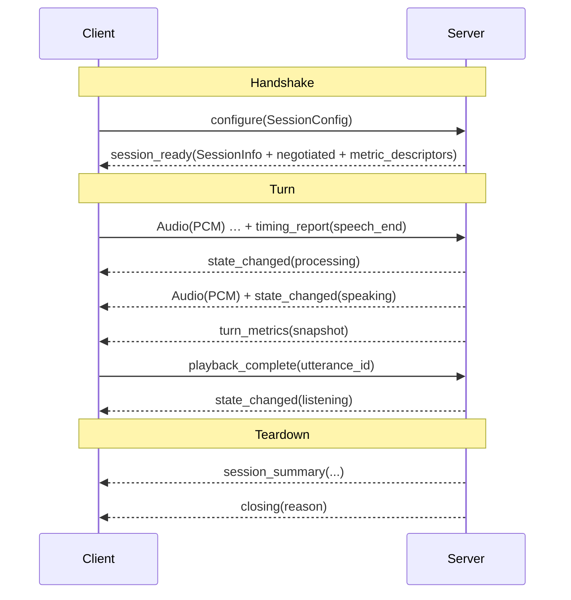
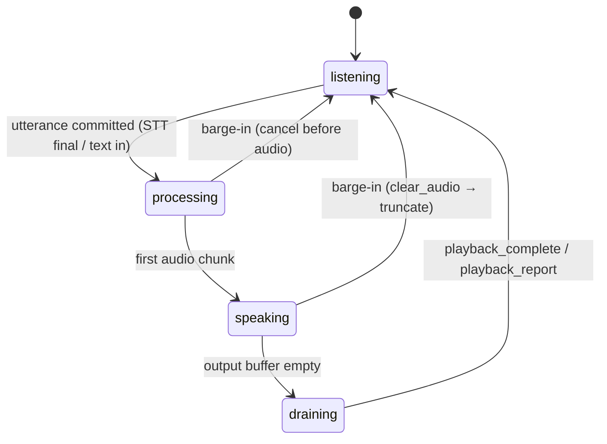

# VPO‑Protocol — Voice Pipeline Open Standard, Layer 3
## Client ↔ Server Contract — Specification v0.1 (Draft)

> **Status:** Draft v0.1. Normative specification for Layer 3 of the Voice Pipeline Open Standard
> (VPO), paired with [VPO-Metrics (Layer 1)](vpo-metrics.md),
> [VPO-Telemetry (Layer 2)](vpo-telemetry.md), and the full client integration reference in
> [Wire protocol](../clients/protocol.md). Layer 3 defines the message contract between a voice
> client and the pipeline server. It is the **reference** layer: a greenfield build adopts it
> wholesale; an existing stack adopts Layers 1–2 (Metrics, Telemetry) and maps its own transport
> onto these semantics.
>
> **Conformance language.** **MUST / MUST NOT / SHOULD / SHOULD NOT / MAY** per RFC 2119.
>
> **Reference implementation.** Every message, field, enum, and default traces to
> `src/transport/mod.rs` (`ClientMessage`, `ServerMessage`, `ClientControl`, `ServerControl`,
> `SessionConfig`, `NegotiatedConfig`, `SessionInfo`, `PipelineState`, `SessionMode`,
> `AudioFormat`, `ConnectionQuality`, `TimingEventKind`, `PROTOCOL_VERSION`).

---

## 1. Scope & goals

### 1.1 What this layer defines
1. **Transport & framing** — how messages are encoded and how protocol versions are negotiated.
2. **Session lifecycle** — handshake, liveness, reconnection, teardown.
3. **The message contract** — every client→server and server→client message, with fields and
   semantics.
4. **The pipeline state machine** — the wire-facing states and their transitions.
5. **The barge-in choreography** — the exact message sequence that makes interruption correct.
6. **The benchmark sub-protocol** — audio injection and TTS-only synthesis for reproducible
   measurement.
7. **Errors, security, and multi-tenancy** requirements.

### 1.2 Relationship to Layers 1–2
This layer is the *carrier*. The metric payloads it transports (`TurnMetrics`, `SessionSummary`,
`metric_descriptors`, the client `TimingReport`/`PlaybackReport`) are defined by
[VPO-Metrics](vpo-metrics.md); the event/lifecycle semantics behind them by
[VPO-Telemetry](vpo-telemetry.md). This document specifies *the wire*, not the meaning of the
numbers.

### 1.3 Principles
- **Transport-agnostic.** The contract is independent of the carrier (WebSocket today;
  WebTransport/QUIC and in-process Direct are reserved). Framing details are carrier-specific;
  message *semantics* are not.
- **Forward-compatible by default.** Discriminators are open strings or carry an `Other` fallback;
  unknown message kinds/actions MUST be ignored, not fatal.
- **Server-authoritative negotiation.** The client proposes; the server's `NegotiatedConfig` is
  binding and the client MUST honor it.

---

## 2. Transport & framing (normative)

### 2.1 Carrier & encoding
The reference carrier is WebSocket (RFC 6455). Control and structured messages are JSON; audio is
carried as binary frames (PCM chunks) out-of-band from the JSON control plane. A conformant
implementation on another carrier MUST preserve message semantics and ordering within a session.

`TransportType` is one of `web_socket`, `web_transport` (reserved), `direct` (in-process: CLI/tests).

### 2.2 Message families
Both directions carry three families:
- **Audio** — a raw PCM `AudioChunk`.
- **Message** — a `PipelineMessage` (structured: text, tool calls, context, cards, images, …).
- **Control** — a tagged control signal (`ClientControl` / `ServerControl`).

Control signals are discriminated by an `action` field (snake_case). `PipelineMessage` is
discriminated by an open `kind` string (e.g. `text`, `tool_call`, `tool_result`, `context`,
`card`, `image`, `trigger_action`, `suggestions`) — new kinds MUST NOT require a protocol bump.

### 2.3 Protocol versioning
The current wire version is `PROTOCOL_VERSION = 1`. The client MAY declare
`SessionConfig.protocol_version`; when omitted the server assumes its current version. The server
echoes its authoritative version in `NegotiatedConfig.protocol_version`. A version mismatch MUST be
surfaced (negotiated value + a server-side warning) so deployments detect drift; it MUST NOT
silently break. Incompatible changes bump the version; additive changes (new control actions, new
`PipelineMessage.kind`, new metric `extras`) MUST NOT.

---

## 3. Session lifecycle (normative)



### 3.1 Handshake
1. Client connects and sends `Control(Configure(SessionConfig))`.
2. Server merges the proposal with pipeline capabilities and replies
   `Control(SessionReady(SessionInfo))`.
3. `SessionInfo` carries `session_id`, a `session_token` (for reconnect), `resumed: bool`, an
   optional echo of `client_config`, and the authoritative `negotiated: NegotiatedConfig`.
4. `NegotiatedConfig` is binding: `audio_format`, `input_sample_rate`, `output_sample_rate`,
   `channels`, resolved `language`/`voice`, informational `stt_provider`/`tts_provider`, resolved
   `mode`, `protocol_version`, and the Layer 1 **`metric_descriptors`**. The client MUST configure
   capture to `input_sample_rate` and playback to `output_sample_rate`.

> **Why descriptors ship at handshake.** Advertising each component's metric layout up front lets a
> generic consumer render/forward any provider's per-turn metrics without hardcoding keys
> (Layer 1 §3.4). This is what makes the metric surface extensible without client code changes.

### 3.2 Liveness & RTT
The client sends `Control(Ping { timestamp_ms })`; the server replies
`Control(Pong { client_timestamp_ms, server_timestamp_ms })`. The echoed client timestamp plus the
server timestamp give a correlated round-trip measurement. **This is the only sanctioned mechanism
for relating the client and server clocks** — and therefore the basis for the one cross-boundary
KPI, barge-in RTT (Layer 1 §6, Layer 2 §3.3). Implementations MUST NOT subtract a raw
client-epoch timestamp from a server timestamp without this correlation.

### 3.3 Reconnection
On a dropped connection the client reconnects and sends
`Control(Resume { session_token })`. The server responds with `SessionReady` carrying
`resumed: true` when the prior session state was recovered. A server MAY decline resumption (issue
a fresh session); clients MUST handle `resumed: false`.

### 3.4 Teardown
The server SHOULD send `Control(SessionSummary { … })` (Layer 1 §7) **immediately before**
`Control(Closing { reason })`. Lightweight clients that do not buffer per-turn `TurnMetrics` rely
on `SessionSummary` for aggregate metrics, so a conformant server MUST emit it before closing on a
normal teardown.

---

## 4. Client → Server messages (normative)

`ClientControl` (`action` discriminator):

| `action` | Fields | Semantics |
|---|---|---|
| `cancel` | — | Barge-in / cancel the current pipeline operation. |
| `ping` | `timestamp_ms` | Liveness; client-epoch ms (§3.2). |
| `configure` | `SessionConfig` | Handshake proposal (§3.1). |
| `resume` | `session_token` | Reconnect to a prior session (§3.3). |
| `playback_report` | `utterance_id`, `last_played_offset_ms`, `last_played_text?` | Sample-accurate report of audio actually played before an interruption. Drives history truncation (Layer 2 §2.4). |
| `playback_complete` | `utterance_id` | The client finished playing an utterance fully. |
| `timing_report` | `utterance_id`, `event`, `client_timestamp_ms`, `detail?` | A client timing event (Layer 1 §4.1). `event` is a `TimingEventKind`. |
| `inject_audio` | `source`, `scenario_id?`, `experiment_id?`, `speed` | Benchmark: inject a pre-recorded WAV into the pipeline (§9). `speed` 1.0 = realtime, 0.0 = as-fast-as-possible. |
| `tts_only_synthesize` | `id`, `text`, `language?`, `voice?` | Benchmark: drive TTS directly, bypassing STT+LLM (§9). |

`ClientMessage::Audio(AudioChunk)` carries input PCM at the negotiated `input_sample_rate`/format.
`ClientMessage::Message(PipelineMessage)` carries structured input (text turns, tool results,
context injection) and is routed by its `kind`.

### 4.1 PlaybackReport precision
`last_played_offset_ms` is the wire field that makes barge-in correct: it is the exact millisecond
offset of audio the client rendered before interrupting. The server MUST use it (when present) to
truncate the assistant's retained history at the heard boundary (Layer 2 §2.4,
`method = playback_report`); absent it, the server falls back to a best-effort
`sentence_boundary` truncation.

---

## 5. Server → Client messages (normative)

`ServerControl` (`action` discriminator):

| `action` | Fields | Semantics |
|---|---|---|
| `session_ready` | `SessionInfo` | Handshake complete (§3.1). |
| `pong` | `client_timestamp_ms`, `server_timestamp_ms` | Liveness echo + RTT basis (§3.2). |
| `state_changed` | `state: PipelineState` | Turn state transition (§6). |
| `quality_update` | `quality: ConnectionQuality` | Connection-quality assessment (§7.2). |
| `error` | `code`, `message`, `severity`, `turn_id?`, `component?` | A pipeline error (§10). |
| `closing` | `reason` | Session teardown (§3.4). |
| `session_summary` | aggregate metrics | Per-session rollup, sent before `closing` (Layer 1 §7). |
| `turn_metrics` | `snapshot: TurnMetricsSnapshot` | Per-turn metric breakdown after each utterance (Layer 1 §3). |
| `clear_audio` | `utterance_id`, `reason` | Flush the client playback buffer immediately (barge-in; §8). |
| `text_truncated` | `utterance_id`, `final_text` | Sync the client transcript to what the user actually heard after a barge-in (§8). |
| `tts_only_result` | `id`, `metrics: TtsOnlyMetrics`, `audio_ref: AudioRef` | Benchmark TTS-only success (§9). |
| `tts_only_error` | `id`, `error` | Benchmark TTS-only failure (§9). |

`ServerMessage::Audio(AudioChunk)` carries output PCM at the negotiated `output_sample_rate`.
`ServerMessage::Message(PipelineMessage)` carries the assistant response and structured outputs.

---

## 6. Pipeline state machine (normative)

The wire-facing `PipelineState` (mirrors the engine `TurnState`) has exactly four states:

| `state` | Meaning |
|---|---|
| `listening` | Waiting for / receiving user speech. |
| `processing` | Running STT / LLM. |
| `speaking` | Streaming/playing TTS audio. |
| `draining` | Output buffer empty; awaiting the client's playback report before completing. |



The server MUST emit `state_changed` on each transition. The `draining` state is significant: it
is where the server waits for `playback_complete` / `playback_report` to finalize the turn (and
metrics) with knowledge of what the client actually played.

---

## 7. Audio format & connection quality (normative)

### 7.1 Audio format negotiation
`AudioFormat` is one of `pcm_i16_le` (default; aliased `pcm_i16`), `pcm_f32_le` (aliased
`pcm_f32`), or `opus` (reserved: no worker decodes or encodes Opus today, so a session that
requests it is always downgraded to `pcm_i16_le` and told so through
`negotiated.options.audio_format_fallback`). Default rates: input
48 kHz (browser-native, avoids lossy browser resampling), mono. The server resolves the actual
rates in `NegotiatedConfig`; the client MUST adopt them. The server MAY pick the output rate
(typically TTS-native) when the client leaves `output_sample_rate` unset.

### 7.2 Connection quality
The server SHOULD emit `quality_update` with a `ConnectionQuality` grade so latency anomalies can
be attributed to the network (Layer 1 §8, Layer 2 §5.4). The grades and their reference thresholds:

| Grade | Threshold |
|---|---|
| `excellent` | RTT < 100 ms, no measurable loss |
| `good` | RTT < 300 ms, loss < 1% |
| `poor` | RTT < 1000 ms, loss < 5% |
| `lost` | no response to pings |

(There is no `fair` grade; the spectrum is excellent → good → poor → lost.)

---

## 8. Barge-in choreography (normative)

Interruption correctness is a *sequence*, not a single message. On a barge-in (server-VAD
detection, an `early_barge` during processing, or a client `cancel`):

1. **Detect** — server detects (or receives `cancel`) and stops producing new audio.
2. **Flush** — server sends `clear_audio { utterance_id, reason }`; the client MUST immediately
   discard buffered playback for that utterance.
3. **Report** — the client sends `playback_report { utterance_id, last_played_offset_ms, … }`
   describing exactly what it played before the flush.
4. **Truncate** — the server truncates the assistant's retained history at the reported boundary
   and emits `text_truncated { utterance_id, final_text }`; the client MUST update its transcript
   to `final_text`.
5. **Resolve** — the turn finalizes via the Telemetry event stream (`barge_in_resolved`,
   Layer 2 §2.3) and the turn snapshot reflects `interrupted: true` with open spans for the
   cut-short stages.

```mermaid
sequenceDiagram
    participant C as Client
    participant S as Server
    Note over C,S: assistant is speaking; user barges in
    C->>S: user speech (or Control cancel)
    Note right of S: detect (server VAD / early_barge / client cancel) — stop new audio
    S-->>C: clear_audio(utterance_id, reason)
    Note left of C: discard buffered playback immediately
    C->>S: playback_report(utterance_id, last_played_offset_ms)
    Note right of S: truncate retained history at heard boundary
    S-->>C: text_truncated(utterance_id, final_text)
    S-->>C: turn_metrics(snapshot{ interrupted:true, open spans })
```

A conformant server MUST send `clear_audio` before `text_truncated`, and MUST prefer the client's
`last_played_offset_ms` over a best-effort boundary when present. A conformant client MUST honor
`clear_audio` synchronously and MUST send `playback_report` after an interruption it observed.

---

## 9. Benchmark sub-protocol (normative for Profile C benchmark conformance)

To make measurement reproducible across stacks, the protocol carries two isolation paths:

### 9.1 Audio injection
`inject_audio { source, scenario_id?, experiment_id?, speed }` feeds a pre-recorded WAV through the
**full** pipeline as if it were live mic input. `speed = 1.0` replays in real time (faithful
latency); `speed = 0.0` replays as-fast-as-possible (throughput). `scenario_id` / `experiment_id`
group runs for comparison.

### 9.2 TTS-only synthesis
`tts_only_synthesize { id, text, language?, voice? }` drives the TTS provider directly, bypassing
STT and LLM, isolating synthesis cost. The server replies `tts_only_result { id, metrics, audio_ref }`
or `tts_only_error { id, error }`. `TtsOnlyMetrics` is a flat surface (`ttfb_ms`, `synthesis_ms`,
`audio_duration_ms`, `sample_rate`, `chars`, `rtf`, `provider`, `cold_start`, `voice`, `error?`);
`AudioRef` points to the produced WAV on the worker host (`path`, `format`, `sample_rate`,
`channels`, `duration_ms`) for out-of-band WER scoring without streaming bytes back.

> These paths are the backbone of the VPO benchmark/scorecard: `tts_only_*` isolates TTS,
> `inject_audio` exercises the whole pipeline deterministically with a known input.

---

## 10. Errors (normative)

`error` carries `code` (programmatic), `message` (human), `severity`, optional `turn_id`, and
optional `component`. `severity` (`ErrorSeverity`) is one of:
- `warning` — non-fatal; pipeline continues, user may not notice.
- `error` — the current turn failed but the session is recoverable (default).
- `fatal` — unrecoverable; the session should be torn down.

`component` (`ErrorComponent`) attributes the failure: `stt`, `llm`, `tts`, `pipeline`,
`transport`. A `fatal` error SHOULD be followed by `closing`. Clients MUST handle an `error`
without a `turn_id` (session-level) distinctly from a turn-scoped one.

---

## 11. Security & multi-tenancy (normative-minimum)

- **Authentication.** The transport MUST authenticate session establishment; the resolved identity
  is carried in session metadata (`auth_identity`).
- **Session tokens.** `session_token` is an opaque reconnection credential; it MUST be
  unguessable and scoped to its session, and resumption MUST re-verify identity.
- **Tenant isolation.** Multi-tenant deployments MUST scope sessions (and their rollups, Layer 2
  §4.3) to a tenant key so no client can address or observe another tenant's sessions.
- **PII.** Transcripts and audio are sensitive. `PipelineMessage` text, `text_truncated.final_text`,
  and `turn_metrics.snapshot.llm_response_text` MAY contain PII; deployments MUST define retention
  and redaction policy for these fields (see [Deployment guide](../guides/deployment.md) for
  session capture retention and authentication configuration).

---

## 12. Conformance

A deployment claims **VPO-Protocol v0.1** conformance iff:

1. It performs the §3 handshake with server-authoritative `NegotiatedConfig` including
   `metric_descriptors`, and the client honors negotiated rates.
2. It implements `ping`/`pong` RTT correlation and uses it (not raw cross-clock subtraction) for
   cross-boundary timing.
3. It implements the full message contract (§4–§5) with open-discriminator forward-compatibility.
4. It emits `state_changed` over the four-state machine (§6), including `draining`.
5. It implements the barge-in choreography (§8) in order, preferring `last_played_offset_ms`.
6. It emits `session_summary` before `closing` (§3.4).
7. It satisfies the security minimums (§11).

**Benchmark conformance** additionally requires the §9 sub-protocol.

### 12.1 Self-certification checklist
- [ ] `Configure` → `SessionReady` with binding `NegotiatedConfig` + `metric_descriptors`.
- [ ] Client adopts `input_sample_rate` / `output_sample_rate`.
- [ ] `ping`/`pong` implemented; barge-in RTT uses correlated RTT only.
- [ ] All `ClientControl` / `ServerControl` actions handled; unknown actions ignored, not fatal.
- [ ] `state_changed` covers `listening/processing/speaking/draining`.
- [ ] Barge-in sequence: `clear_audio` → client `playback_report` → `text_truncated`.
- [ ] `session_summary` precedes `closing`.
- [ ] `error.severity` ∈ {warning, error, fatal}; `component` attributed; `fatal` → `closing`.
- [ ] Benchmark paths (`inject_audio`, `tts_only_*`) implemented for benchmark conformance.
- [ ] Auth on establish; opaque scoped `session_token`; tenant isolation; PII policy defined.

---

## Appendix A — Message contract quick-reference

```
CLIENT -> SERVER
  Audio(AudioChunk)
  Message(PipelineMessage{ kind, text?, payload?, binary?, role, turn_id?, message_id })
  Control(ClientControl):
    cancel | ping{timestamp_ms} | configure(SessionConfig) | resume{session_token}
    playback_report{utterance_id,last_played_offset_ms,last_played_text?}
    playback_complete{utterance_id}
    timing_report{utterance_id,event,client_timestamp_ms,detail?}
    inject_audio{source,scenario_id?,experiment_id?,speed}
    tts_only_synthesize{id,text,language?,voice?}

SERVER -> CLIENT
  Audio(AudioChunk)
  Message(PipelineMessage)
  Control(ServerControl):
    session_ready(SessionInfo) | pong{client_timestamp_ms,server_timestamp_ms}
    state_changed{state} | quality_update{quality}
    error{code,message,severity,turn_id?,component?} | closing{reason}
    session_summary{turns,interrupted_turns,avg_ttft_ms?,avg_ttfb_ms?,avg_total_ms?,total_audio_duration_ms}
    turn_metrics{snapshot} | clear_audio{utterance_id,reason} | text_truncated{utterance_id,final_text}
    tts_only_result{id,metrics,audio_ref} | tts_only_error{id,error}

ENUMS
  SessionMode:       voice | text | hybrid | voice_in_text_out | text_in_voice_out
  PipelineState:     listening | processing | speaking | draining
  AudioFormat:       pcm_i16_le | pcm_f32_le | opus (reserved; always negotiated down to pcm_i16_le)
  ConnectionQuality: excellent | good | poor | lost
  ErrorSeverity:     warning | error | fatal
  ErrorComponent:    stt | llm | tts | pipeline | transport
  TimingEventKind:   speech_start | speech_end | audio_receive | playback_start
                     | first_byte_played | playback_end | underrun | <other>
  TransportType:     web_socket | web_transport | direct
  PROTOCOL_VERSION = 1
```

## Appendix B — Handshake & barge-in sequence (informative)

```
Handshake
  C -> S  configure(SessionConfig{ mode, sample_rate:48000, channels:1, voice, protocol_version:1 })
  S -> C  session_ready(SessionInfo{ session_id, session_token, resumed:false,
                          negotiated:{ input_sample_rate:48000, output_sample_rate:24000,
                                       audio_format:pcm_i16_le, mode, metric_descriptors:[stt,llm,tts] } })

Normal turn
  C -> S  Audio(...) ...                        S -> C  state_changed{processing}
  C -> S  timing_report{speech_end}             S -> C  Audio(...) state_changed{speaking}
                                                S -> C  turn_metrics{snapshot{ utterance_id, total_ms, components }}
  C -> S  playback_complete{utterance_id}       S -> C  state_changed{listening}

Barge-in
  (user speaks over playback)                   S -> C  clear_audio{utterance_id, reason:"barge_in"}
  C -> S  playback_report{utterance_id, last_played_offset_ms:1840}
                                                S -> C  text_truncated{utterance_id, final_text:"...heard portion"}
                                                S -> C  turn_metrics{snapshot{ interrupted:true, ...open spans }}

Teardown
                                                S -> C  session_summary{ turns, interrupted_turns, avg_ttfb_ms, ... }
                                                S -> C  closing{ reason:"client_disconnect" }
```
