# VPO‑Telemetry — Voice Pipeline Open Standard, Layer 2
## Turn Lifecycle, Event Stream, Correlation, Aggregation & Health — Specification v0.1 (Draft)

> **Status:** Draft v0.1. Normative specification for Layer 2 of VPO
> (see VPO-BLUEPRINT-OUTLINE.md, Part 4). Layer 2 sits on top of
> [VPO-Metrics v0.1](vpo-metrics.md): Metrics defines *what is measured*; Telemetry defines
> *how it is emitted, correlated, aggregated, and turned into a health signal*.
>
> **Conformance language.** **MUST / MUST NOT / SHOULD / SHOULD NOT / MAY** per RFC 2119.
>
> **Reference implementation.** Every event, field, and rule traces to:
> `src/pipeline/events.rs` (`PipelineEvent`, `InterruptionTrigger`, `HistoryModification`,
> `TruncationMethod`), `voice-pipes-admin/backend/app/analytics/rollup.py` (durable rollup store),
> and `voice-pipes-admin/backend/app/report/analysis.py` (`_detect_anomalies`,
> `_distribution_stats`, `_compute_verdict`, `_DEFAULT_TARGETS`, `_PROVIDER_TARGETS`).

---

## 1. Scope & goals

### 1.1 What this layer defines
1. The **pipeline event stream** — a structured, serializable, broadcastable record of everything
   that happens in a turn, decoupled from any single client connection.
2. The **correlation model** — how client timing (Layer 1 §4.1), server component spans
   (Layer 1 §4.2), and the event stream stitch into one **turn waterfall** via `utterance_id`.
3. **Aggregation & rollups** — how per-turn data reduces to per-session and per-window
   statistics deterministically and cheaply (freshness-keyed cache, pipeline partitioning,
   percentile method).
4. The **anomaly taxonomy** — the normative set of anomaly kinds, their target rubric, and the
   provider-aware target resolution that keeps them low-noise.
5. The **health verdict model** — how anomalies + stability reduce to a session verdict, and how
   sessions reduce to a fleet health signal.
6. The **observability surface contract** — the minimum a conformant console exposes so signals
   are *observed together*, not in isolation.

### 1.2 What this layer does NOT define
- The metric catalog / units / SLO numbers — that is Layer 1.
- The client↔server wire protocol — that is Layer 3 (VPO-Protocol).
- Storage engine choices — the rollup *contract* is normative; SQLite/WAL is a reference detail.

### 1.3 Principles
- **Correlation-first.** Every event carries `utterance_id`; the turn is the atomic unit.
- **Truthful absence.** A missing signal MUST be representable as "not measured", never silently
  coerced to zero. (Reference: error counts are dropped, not reported as `0`, when the event
  stream was not scanned.)
- **Low-noise by construction.** Anomaly thresholds MUST be provider-aware; a metric that does not
  apply to a provider mode (e.g. batch `processing_ms` for a streaming STT) MUST NOT be flagged.
- **Decoupled emission.** Event consumers (audit, webhooks, aggregators, agentic memory) MUST be
  able to subscribe without coupling to pipeline internals (broadcast, not callback).

---

## 2. The pipeline event stream (normative)

### 2.1 Envelope
Each event is a tagged, serializable record discriminated by a `kind` field (snake_case). Events
MUST be cheaply cloneable (fan-out to many consumers) and forward-compatible (an unknown `kind`
MUST be ignored, not rejected). All events except session-global ones carry `utterance_id`.

### 2.2 Canonical event vocabulary
(Reference: `PipelineEvent`, serialized `#[serde(tag = "kind", rename_all = "snake_case")]`.)

| `kind` | Key fields | Emitted when |
|---|---|---|
| `utterance_received` | `utterance_id`, `text`, `source` | A new utterance arrives (STT final or text input). `source` distinguishes voice vs text. |
| `stt_completed` | `utterance_id`, `elapsed_ms?` | STT final transcript ready. `elapsed_ms` from end-of-speech to final transcript; `null` for text-source turns. |
| `llm_started` | `utterance_id` | LLM processing began. |
| `llm_first_token` | `utterance_id`, `elapsed_ms` | First LLM token arrived (TTFT marker). |
| `llm_completed` | `utterance_id`, `text_len`, `elapsed_ms`, `is_partial` | LLM finished. `is_partial` = generation was cut (e.g. interrupt). |
| `tts_started` | `utterance_id` | TTS synthesis began. |
| `tts_first_audio` | `utterance_id`, `elapsed_ms` | First audio chunk ready (TTFB marker). |
| `tts_completed` | `utterance_id` | All audio synthesized. |
| `turn_completed` | `utterance_id`, `total_ms` | Turn finished without interruption. |
| `interrupted` | `utterance_id`, `trigger`, `played_ms?` | User interrupted. See §2.3. |
| `barge_in_resolved` | `utterance_id`, `trigger`, `played_ms?`, `retained_text`, `barge_in_rtt_ms?` | Emitted **once** per interrupted turn after truncation completes. Supersedes the prior `interrupted`. |
| `history_modified` | `modification` | Conversation history changed (e.g. truncation). See §2.4. |
| `client_timing` | `utterance_id`, `timing_event`, `client_timestamp_ms` | A client timing report (Layer 1 §4.1) entered the stream. |
| `caption_emitted` | `utterance_id`, `fragment_idx`, `text` | Caption metadata for an audio segment. |
| `pipeline_error` | `utterance_id?`, `component`, `message` | A pipeline error. `utterance_id` may be absent for session-level errors. |
| `turn_metrics_ready` | `utterance_id`, `metrics` | The full Layer 1 `TurnMetricsSnapshot` for the turn — the event-stream counterpart of the wire `TurnMetrics` message. |

A conformant producer MUST emit `utterance_received`, the relevant stage events, exactly one
terminal event per turn (`turn_completed` **or** `barge_in_resolved`), and `turn_metrics_ready`.

### 2.3 Interruption events
`trigger` is one of (`InterruptionTrigger`, snake_case): `server_vad` (server detected barge-in),
`client_cancel` (explicit Cancel control), `early_barge` (user spoke during LLM processing).

Ordering guarantee: on an interruption a producer MUST emit `interrupted` first, then perform
truncation, then emit exactly one `barge_in_resolved`. Consumers MUST treat `barge_in_resolved`
as authoritative and the earlier `interrupted` as provisional.

### 2.4 History modification
`history_modified.modification` (`HistoryModification`) carries: `utterance_id`, `original_text`
(full LLM output), `retained_text` (what the user actually heard / what stays in history),
`method`, and `played_ms?`. `method` is one of (`TruncationMethod`): `sentence_boundary`
(best-effort, no client report) or `playback_report` (sample-accurate, derived from the client's
`PlaybackReport`). `played_ms` is present iff `method == playback_report`.

> **Why this is in the standard.** Sample-accurate truncation is what keeps the agent's memory
> consistent with what the user heard after a barge-in. A conformant pipeline SHOULD prefer
> `playback_report` and MUST record which method was used so downstream memory/analytics know the
> fidelity of `retained_text`.

---

## 3. Correlation model (normative)

### 3.1 The join key
All per-turn signals are joined by `utterance_id`. A consumer assembling a turn waterfall MUST key
on `utterance_id` and MUST NOT rely on event arrival order across the client/server boundary
(client timing events arrive asynchronously relative to server spans).

### 3.2 The turn waterfall
A conformant consumer reconstructs one turn as:
1. **Server spans** (from `turn_metrics_ready.metrics.components`) laid out by `started_at_ms`
   relative to turn start.
2. **Server stage markers** (`stt_completed`, `llm_first_token`, `tts_first_audio`, …) as
   checkpoints within those spans.
3. **Client timing events** (`client_timing` / Layer 1 §4.1) laid onto the same turn, anchored at
   `speech_end`.
4. **Derived KPIs** (Layer 1 §6) computed from the stitched signals.

The result is one stitched timeline — server spans (server clock, turn-relative) and client
markers (client clock) on the same turn, keyed by `utterance_id` (same worked turn as
[VPO-Metrics](vpo-metrics.md) Appendix B):

```mermaid
gantt
    title Turn waterfall — utterance_id=42 (client + server stitched)
    dateFormat x
    axisFormat %S.%Ls
    section Client
    speech 900ms then wait     :done,   0, 900
    TTFA 550ms -> audio_receive :active, 900, 1450
    section Server spans
    STT processing 180ms       :crit,   0, 180
    LLM ttft 240 / gen 600     :active,  190, 810
    TTS ttfb 300 / synth 880   :active,  820, 1720
```



### 3.3 Cross-clock rule
Client timestamps (`client_timestamp_ms`, client-epoch) and server timestamps (monotonic,
turn-relative) live in different clocks. A consumer MUST NOT subtract one from the other directly.
Cross-boundary KPIs (notably barge-in RTT) MUST use the protocol's correlated RTT (Layer 3).
Within-client deltas (TTFA, perceived first-sound) and within-server deltas (per-stage latency)
are computed in their own clock and are always valid.

### 3.4 Partial turns
An interrupted turn yields open spans (Layer 1 §3.2) and a `barge_in_resolved` instead of
`turn_completed`. Consumers MUST render partial turns as partial — never discard them and never
backfill missing finish times. Partial turns are first-class for interruption analytics.

---

## 4. Aggregation & rollups (normative)

### 4.1 Reduction levels
- **Turn** → per-component spans + derived KPIs (Layer 1).
- **Session** → a *rollup*: flattened per-turn rows, per-component aggregates, ordered cost
  events, error counts, anomalies, and a health verdict.
- **Window / fleet** → statistics over many sessions, optionally filtered by `pipeline_name`.

### 4.2 Freshness-keyed rollup contract
A session rollup MUST be reusable without re-parsing when, and only when, the session is
unchanged. Conformant implementations MUST key reuse on a **freshness signature** that bumps on
any content change. The reference signature is `(events_mtime, dir_mtime, schema_ver)`:
- `events_mtime` bumps when the live session appends to its event log;
- `dir_mtime` bumps when a new turn artifact is added;
- `schema_ver` invalidates all rows on a format change.

A rollup row MUST be discarded (recomputed) if **any** signature component mismatches. The store
MUST be a cache, never a correctness dependency: a store read/write error MUST force a recompute,
not an error. (Reference: `rollup.get_fresh` / `rollup.put` never raise.)

### 4.3 Pipeline partitioning
Rollups MUST carry `pipeline_name` and MUST be indexable by `(pipeline_name, start_ts)` so a
windowed or single-pipeline query never scans another pipeline's data. Multi-tenant deployments
MUST partition on `pipeline_name` (or a stricter tenant key) at the query layer.

### 4.4 Percentile method
Aggregations report `min / p50 / p90 / p99 / max`. For the small-n (≈ ≤ 50 turns) per-session
bucket, the **nearest-rank** percentile is the normative method (no interpolation, no numpy
dependency). Larger windows MAY use histogram percentiles provided the method is declared.

### 4.5 Stability / dispersion signals
Per-component aggregates MUST expose dispersion, not just central tendency:
`mean`, `stddev`, `iqr` (= p90 − p50), and `p99_p50_ratio` (heavy-tail detector). A component is
classified `stability ∈ {stable, variable, unstable}`:
- `unstable` when `p99_p50_ratio > 5.0` (and n ≥ 3),
- `variable` when `> 2.0`,
- `stable` otherwise.

> **Why dispersion is mandatory.** A healthy p50 with a p99 tail 5× higher is a worse user
> experience than a slightly higher but flat p50. Reporting only averages hides the turns users
> actually notice.

---

## 5. Anomaly taxonomy (normative)

### 5.1 Anomaly record shape
An anomaly is `{ utt, kind, level, observed, target, detail }` where `level ∈ {info, warn}`.
`info` anomalies are explanatory context and MUST NOT count toward a health verdict; `warn`
anomalies do (§6).

### 5.2 Canonical anomaly kinds
Kinds use the form `<component>.<signal>` and are normative:

| Kind | Default level | Condition (vs resolved target) |
|---|---|---|
| `llm.ttft_high` | warn¹ | LLM time-to-first-token over target. |
| `llm.throughput_low` | warn | tokens/sec under target (only when not cold, ≥30 completion tokens, generation > 200 ms). |
| `tts.ttfb_high` | warn | TTS time-to-first-byte over target (only when synthesis completed). |
| `tts.rtf_high` | warn | TTS realtime factor over target (synthesis slower than playback). |
| `tts.audio_truncated` | warn | Chars present but ≈no audio — likely synthesis failure (non-interrupted turns). |
| `stt.processing_high` | warn | STT transcription latency over target (batch STT only). |
| `stt.endpointing_high` | warn | VAD endpointing over target (slow turn-taking). |
| `bi.likely_self_barge` | info | `server_vad` barge-in with `played_ms` below the self-barge floor — likely echo. |
| `bi.rtt_high` | warn¹ | Barge-in round-trip over target (user hears stale TTS). |
| `turn.total_outlier` | info | Turn `total_ms` > `outlier_total_ms_factor` × session median. |

¹ Demoted to `info` under documented benign conditions (§5.4): e.g. connect-dominated TTFT,
estimated TTFT, ≤5% marginal overage; or a real user barge-in (`played_ms ≥ 1000`) with ≤1.5×
RTT overage.

New anomaly kinds MAY be added, but each MUST: (a) declare a component owner (§6.2), (b) declare a
default level, (c) specify the exact condition and the target it reads.

### 5.3 Target rubric & provider-aware resolution
Anomalies are evaluated against a resolved target set. Resolution order (last wins):
**baseline defaults → provider/model overrides → caller overrides.** Reference baseline
(`_DEFAULT_TARGETS`): `ttft_ms 300`, `ttfb_ms 400`, `endpointing_ms 500`, `stt_processing_ms 800`,
`rtf_max 0.6`, `tokens_per_sec_min 30`, `barge_in_rtt_ms 400`, `self_barge_played_ms_max 200`,
`outlier_total_ms_factor 2.0`.

Provider/model overrides are **mandatory** for low noise: a cloud LLM legitimately streams at a
higher TTFT and lower tok/s than a local model, so holding it to local targets manufactures false
positives. (Reference: `_PROVIDER_TARGETS` raises `openai-compat` `ttft_ms` to 800–1500 and lowers
`tokens_per_sec_min` per model family.)

### 5.4 Provider-mode awareness (MUST)
A metric that does not apply to a provider's mode MUST NOT be flagged:
- **Streaming STT** providers have no meaningful `processing_ms` (transcript arrives during
  speech) — `stt.processing_high` MUST be skipped; report `stream_duration_ms` instead.
- **Interrupted turns** have cut-short synthesis (`synthesis_ms` null) — `tts.ttfb_high` MUST be
  skipped (the measured TTFB includes interrupt-handling stalls, not TTS slowness).
- **Connect-dominated TTFT** (cold TLS/TCP socket where `connect_ms / first_token_ms > 0.9`) MUST
  be demoted to `info` and attributed to transport, not the model.
- **Cold-start turn** latency thresholds are skipped (informational), since model-load dominates.

### 5.5 Throughput & annotator anomaly kinds (reference implementation, 2026-08)

Implemented in `report/anomalies.py`; each declares an owner, a default level and a condition per §5.2 (the
§5.1 level set gains `error` for these). They read the per-turn `output` and `audio_post:<name>`
components and the client `playback_quality` frame (`arrival_wall_ms`, `annotation_late_*`).
Targets: `emit_rtf_max 0.9`, `post_budget_ratio_max 0.8`, `annotation_lag_budget_ms 200`.

| Kind | Owner | Default level | Condition (vs resolved target) |
|---|---|---|---|
| `output.slower_than_realtime` | provider (`s2s` / `tts`), or `audio_post` when `emit_rtf − source_rtf > 0.3` | warn / error by band (1.0 / 1.2 / 1.5) | `output.emit_rtf > 1.0`: the server emitted N s of audio in M s; the client starves once its prebuffer drains. |
| `audio_post.over_budget` | `audio_post:<name>` | error | Any inline post-processor with `budget_ratio > 1.0` (mean call latency ÷ mean chunk audio duration) or `timeouts > 0`. |
| `client.starvation` | server output (same attribution as `output.slower_than_realtime`) | warn | `underrun_count > 0` **and** `arrival_rtf = arrival_wall_ms / audio_ms > 1.0` — audio arrived slower than it plays. |
| `client.jitter` | transport / client prebuffer | warn | `underrun_count > 0` and `arrival_rtf ≤ 1.0` — arrivals kept up on average but were bursty for the prebuffer. Replaces the former undifferentiated underrun reading. |
| `annotator.lagging` | `annotator:<name>` | warn | `annotator:<name>.lag_max_ms > annotation_lag_budget_ms` or client `annotation_late_ms_max > 0`. |
| `annotator.degraded` | `annotator:<name>` | warn | `timeouts > 0` or `dropped_chunks > 0` for the turn. |
| `annotator.unavailable` | `annotator:<name>` | error (metadata) | `breaker_open` at any point in the turn. |

**Reading throughput anomalies (operator guide).**
- The verdict can now name **`POST-PROCESSOR (<name>)`** (culprit `audio_post`). It is chosen — with
  severe weight — when `emit_rtf − source_rtf > 0.3`: the inline chain, not the model, added the wall
  time. It is never collapsed into the fused `s2s` culprit. Fix: keep per-chunk work under the chunk
  duration, or move metadata processors off the audio path (`mode = "annotate"`,
  [AUDIO-ANNOTATORS.md](../guides/audio-annotators.md)).
- `output.slower_than_realtime` with `source_rtf ≈ emit_rtf` means the **provider** delivers audio
  slower than real time (headline "delivers audio slower than real time" on `s2s` / `tts`), not a
  processor.
- `client.starvation` corroborates a server-side `emit_rtf > 1` from the client's point of view;
  `client.jitter` with a healthy `emit_rtf` points at the network or a too-small prebuffer — do not
  tune the server for it.
- `annotator.*` kinds are a **metadata** dimension: culprit label
  `ANNOTATOR (<name>) — metadata only, audio unaffected`; an annotator anomaly alone caps the session
  level at `fair`.
- Report targets: `emit_rtf <= 0.9`, `post_budget_ratio <= 0.8`. For s2s pipelines the report's `rtf`
  is the streaming-phase `emit_rtf`; `source_rtf` isolates the model, `chain_overhead_ms` the
  post-processors (their summed call time, 0 when none ran) and `pacer_wait_ms` the rest of the
  emit − source wall time, mostly the realtime pacer. A slow emit is blamed on a post-processor only
  when the turn ran one.

### 5.6 Speech-to-speech latency anchoring (reference implementation, 2026-08)

Implemented in `report/anomalies.py`, `report/verdict.py` and `captures/reader.py`. A speech-to-speech turn has
no `synthesis_ms`, no `llm.ttft_ms` and no cascade `endpointing_ms`; its user-felt wait decomposes
into `provider_endpointing_ms` (how late the provider's VAD/transcription noticed the user stopped,
measured against vp's own uplink VAD stamp `vp_speech_end_epoch_ms`) + `ttfb_ms` (provider anchor →
first **audio** delta; `first_text_ms` is the diagnostic first-transcript instant). No new numeric
targets: `endpointing_ms` applies to `provider_endpointing_ms`, `ttfb_ms` to the real TTFB.

**Anchor sources.** Every S2S latency carries its provenance in `ttfb_anchor_source`
(per-turn `anchor` block in the report rows; the E2E has its own `e2e_anchor_source`):
`provider_speech_stopped` (OpenAI `input_audio_buffer.speech_stopped`), `input_transcript_proxy`
(Gemini today — the last input-transcript delta, which lands 0.45–1.0 s *after* the user stopped),
`vp_vad` (vp's uplink-VAD observer), `client_speech_end` (the client's VAD `speech_end` timing
report), `text_submit`, and `turn_start` (**no** anchor: that turn's `ttfb_ms` is ≈ 0 by construction
and MUST NOT be read as latency or E2E). Legacy captures without the key are labelled `provider`
when `user_speech_end_epoch_ms` is present. `e2e_perceived_ms` is built per turn from the best
available pair — client `speech_end` › `vp_speech_end_epoch_ms` › provider anchor › cascade commit
proxy — and never mixes sources within a turn; a turn without a client `audio_receive` report falls
back to the anchored server-side estimate (`e2e_estimated`), never for `turn_start`.

| Kind | Owner | Default level | Condition (vs resolved target) |
|---|---|---|---|
| `tts.ttfb_high` (S2S) | `s2s` (the model; `tts` before the collapse) | warn / **error** from the severe band (≥ 2.5 × target) | Now also raised for a speech-to-speech turn: `ttfb_ms > ttfb_ms` target when the turn was not interrupted, produced audio (`audio_output_ms > 0`) **and** `ttfb_anchor_source` is an honest anchor (`provider_speech_stopped`, `input_transcript_proxy`, `vp_vad`, `client_speech_end`, `text_submit`). Not raised for `turn_start` or legacy `provider` captures (their `ttfb_ms` may be first-*text* stamped). Detail: `speech-to-speech model: end of speech (<source>) → first audio`. Cascade behaviour unchanged. |
| `stt.endpointing_high` (S2S) | `s2s` (the model; `stt` before the collapse) | warn | Now also raised from `provider_endpointing_ms > endpointing_ms` target, on the critical path. Detail: `provider VAD/transcription noticed the end of speech N ms late (anchor: <source>)`. |
| `s2s.anchor_proxy` | `s2s` | info (severity negligible; never affects the level) | `ttfb_anchor_source == input_transcript_proxy` and neither `vp_speech_end_epoch_ms` nor a client `speech_end` stamp exists: `TTFB/E2E measured from a late proxy (provider input transcript); real wait is longer`. |

**Reading S2S latency anomalies (operator guide).**
- The `s2s` headline now distinguishes the fix: *"answers late (TTFB p50 N ms from `<source>`)"* when
  `tts.ttfb_high` dominates (model / provider choice) vs *"is slow to notice the end of speech
  (endpointing p50 N ms)"* when `stt.endpointing_high` dominates (provider VAD tuning — see the plan's
  WP7), alongside the throughput verb from §5.5.
- An `s2s.anchor_proxy` row means every latency on that turn under-reports; enable vp's endpoint
  observer or a client with VAD `speech_end` reports to get a real anchor.

---

## 6. Health verdict model (normative)

### 6.1 Session verdict
A session reduces to `{ level, primary_culprit, headline, supporting_anomaly_kinds,
unstable_components }` where `level ∈ {healthy, degraded, broken}`.

- `broken` — the session terminated mid-flight at scale (reference: ≥50% of turns terminated).
- `healthy` — zero `warn`-level anomalies. A purely jittery component (`unstable` but no turn
  breached its target) stays `healthy` with an `unstable_components` note — jitter alone is not a
  user-visible defect.
- `degraded` — otherwise (one or more `warn` anomalies, or instability with breaches).

Only `warn` anomalies count toward the verdict; `info` rows are explanatory.

### 6.2 Culprit attribution
Each anomaly kind maps to exactly one responsible component via a flat ownership table
(`_ANOMALY_COMPONENT`): `llm.*→llm`, `tts.*→tts`, `stt.*→stt`, `bi.rtt_high→transport`,
`bi.likely_self_barge→stt`, `turn.total_outlier→turn`. The `primary_culprit` is the component with
the most `warn` anomalies, tie-broken toward `unstable` components. Adding an anomaly kind MUST
extend this table.

### 6.3 Fleet health (normative)
Across workers/pipelines, health MUST be a **fraction-healthy** model — *X of Y workers healthy* —
not worst-of-one. A single unhealthy worker MUST NOT paint an entire multi-worker pipeline red.
Per-pipeline status aggregates its workers; per-component health exposes p50/p90/p99 histograms.
(Reference: `PipelinesHealth` derives fraction-healthy + color from per-component latency.)

### 6.4 Burn-rate & gauges
SLO compliance (Layer 1 §9) SHOULD be surfaced as budget burn-rate, with the budget gauge
color-coding from Layer 1 §9.3 (green ≤80%, amber 80–100%, red >100%).

---

## 7. Observability surface contract (normative-minimum)

So signals are *observed together*, a conformant console MUST provide at least:

1. **An overview / NOC view** — per-pipeline fraction-healthy status + top active anomalies.
2. **A turn-detail waterfall** — the §3.2 stitched view (server spans + client timing on one
   timeline) with the per-turn metric breakdown and, where available, synced audio.
3. **A session list** — filterable by `pipeline_name`, time window, and verdict `level`.
4. **A live health view** — per-component p50/p90/p99 and per-worker status.

A surface MUST render any descripted metric (Layer 1 §3.4) without hardcoding its key, so new
provider metrics appear automatically.

---

## 8. OpenTelemetry alignment (informative → normative in v0.2)

- Each `PipelineEvent` maps to a span event on the turn span (Layer 1 §11), `vpo.event.kind = <kind>`.
- `barge_in_resolved` additionally emits the `vpo.barge_in_rtt_ms` instrument.
- Anomalies map to span events `vpo.anomaly` with `vpo.anomaly.kind`, `vpo.anomaly.level`,
  `vpo.anomaly.observed`, `vpo.anomaly.target`, and `vpo.component` (the culprit).
- The session verdict maps to resource/log attributes `vpo.verdict.level`,
  `vpo.verdict.primary_culprit`.

---

## 9. Conformance

A deployment claims **VPO-Telemetry v0.1** conformance iff:

1. It emits the event stream (§2) with the interruption ordering guarantee and one terminal event
   + `turn_metrics_ready` per turn.
2. It exposes the correlation join (§3) and honors the cross-clock rule.
3. Its session rollups are freshness-keyed and pipeline-partitioned (§4.2–§4.3), with dispersion
   signals (§4.5).
4. It computes anomalies from the canonical taxonomy (§5) with provider-aware, mode-aware target
   resolution.
5. It reduces to a session verdict (§6.1–§6.2) and a fraction-healthy fleet signal (§6.3).
6. It provides the minimum observability surfaces (§7).

### 9.1 Self-certification checklist
- [ ] Every event carries `utterance_id` (except session-global) and an ignorable-unknown `kind`.
- [ ] Interruptions emit `interrupted` → truncate → one `barge_in_resolved`.
- [ ] `history_modified` records `method` (`sentence_boundary` | `playback_report`).
- [ ] Turn waterfall stitches client + server by `utterance_id`, never by arrival order.
- [ ] No raw client-epoch − server-monotonic subtraction anywhere.
- [ ] Rollups keyed on `(events_mtime, dir_mtime, schema_ver)`; store errors force recompute.
- [ ] Aggregates include `p99_p50_ratio` + `stability`.
- [ ] Streaming-STT `processing_high` and interrupted-turn `ttfb_high` are suppressed.
- [ ] Provider/model target overrides applied before caller overrides.
- [ ] Fleet health is fraction-healthy, not worst-of.

---

## Appendix A — Event vocabulary quick-reference

```
Lifecycle:  utterance_received, stt_completed, llm_started, llm_first_token,
            llm_completed, tts_started, tts_first_audio, tts_completed
Terminal:   turn_completed | barge_in_resolved      (exactly one per turn)
Interrupt:  interrupted, barge_in_resolved, history_modified
            trigger ∈ {server_vad, client_cancel, early_barge}
            method  ∈ {sentence_boundary, playback_report}
Side:       client_timing, caption_emitted, pipeline_error, turn_metrics_ready
```

## Appendix B — Anomaly kinds & owners

```
llm.ttft_high          -> llm        (info if connect-dominant / estimated / <=5% over)
llm.throughput_low     -> llm
tts.ttfb_high          -> tts        (skipped on interrupted turns; S2S: -> s2s, needs an honest
                                      ttfb_anchor_source, error from 2.5x target — §5.6)
tts.rtf_high           -> tts
tts.audio_truncated    -> tts
stt.processing_high    -> stt        (skipped for streaming STT)
stt.endpointing_high   -> stt        (S2S: -> s2s, from provider_endpointing_ms — §5.6)
bi.likely_self_barge   -> stt        (info)
bi.rtt_high            -> transport  (info if real user barge-in & <=1.5x over)
turn.total_outlier     -> turn       (info)

# §5.5 — throughput & annotator kinds
output.slower_than_realtime -> s2s/tts, or audio_post when emit_rtf - source_rtf > 0.3
audio_post.over_budget      -> audio_post:<name>    (error; never collapsed into s2s)
client.starvation           -> server output        (underruns and arrival_rtf > 1)
client.jitter               -> transport/prebuffer  (underruns and arrival_rtf <= 1)
annotator.lagging           -> annotator:<name>     (metadata only; session <= fair)
annotator.degraded          -> annotator:<name>     (metadata only; session <= fair)
annotator.unavailable       -> annotator:<name>     (error, metadata only; session <= fair)

# §5.6 — speech-to-speech anchoring
s2s.anchor_proxy            -> s2s                  (info; ttfb_anchor_source = input_transcript_proxy
                                                     with no vp/client end-of-speech stamp)

Verdict: warn-only count -> level {healthy|degraded|broken};
         primary_culprit = component with most warns, tie-break to unstable.
```

## Appendix C — Note on the outline's placeholder taxonomy

VPO-BLUEPRINT-OUTLINE.md §4.4 listed placeholder anomaly flags
(`high_latency`, `underrun`, `barge_storm`, `quota_breach`, `low_success`). The normative taxonomy
is §5 here — `<component>.<signal>` kinds with provider/mode-aware resolution and a verdict
reducer — matching the reference implementation in `report/analysis.py`. The outline should be
updated to point here.
